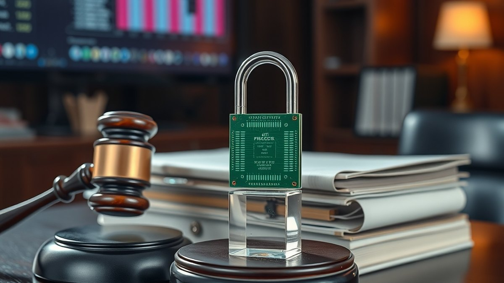
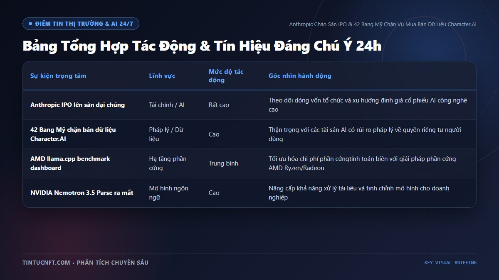

## Toàn Cảnh Vĩ Mô & Công Nghệ 24h

*Ảnh tư liệu: As Anthropic IPOs, Grand Theft Auto VI proves why efficiency isn’t a virtue (Nguồn: TechCrunch AI)*

Thị trường tài chính và công nghệ toàn cầu trong 24 giờ qua đang chứng kiến những bước ngoặt lịch sử khi ranh giới giữa giá trị vốn hóa công nghệ lớn và tính nhân bản của dữ liệu bị thử thách gay gắt. **[TechCrunch AI]** ghi nhận sự kiện chấn động khi **Anthropic chính thức bước chân vào thị trường đại chúng (IPO)**, mở ra một kỷ nguyên mới cho dòng vốn thể chế rót vào các mô hình ngôn ngữ lớn hàng đầu. Song song với đó, áp lực pháp lý từ các cơ quan quản lý nhà nước cũng gia tăng chưa từng có, tiêu biểu là việc **[The Verge AI] tổng hợp 42 tổng chưởng lý các bang Mỹ đang hợp lực ngăn chặn Character.AI bán dữ liệu trò chuyện của người dùng** trong tiến trình phá sản Chapter 11. Sự đối lập này phản ánh bức tranh vĩ mô đầy biến động: một mặt là dòng tiền khổng lồ khao khát hiệu suất và tốc độ từ AI, mặt khác là hàng rào pháp lý khắt khe nhằm bảo vệ quyền riêng tư cá nhân.

## Đột Phá AI, Hạ Tầng Mô Hình & Hệ Sinh Thái Agent

Cuộc đua hạ tầng AI và tối ưu hóa hiệu suất tính toán đang diễn ra quyết liệt trên mọi mặt trận phần cứng lẫn phần mềm. 

- **[TechCrunch AI] As Anthropic IPOs, Grand Theft Auto VI proves why efficiency isn’t a virtue**: Sự kiện Anthropic IPO diễn ra cùng ngày với việc Grand Theft Auto VI khẳng định vị thế bom tấn giải trí nhân bản tốn nhiều năm phát triển, đặt ra câu hỏi lớn về việc liệu tối ưu hóa hoàn toàn bằng AI có thực sự là ưu tiên tuyệt đối hay những giá trị thủ công mới là chìa khóa thành công. Sự kiện này buộc các nhà đầu tư mạo hiểm phải cân nhắc lại chiến lược phân bổ vốn giữa các startup AI thuần túy và các ngành công nghiệp sáng tạo truyền thống có chiều sâu. [Xem chi tiết tại TechCrunch](https://techcrunch.com/2026/11/26/as-anthropic-ipos-grand-theft-auto-vi-proves-why-efficiency-isnt-a-virtue/)

- **[Hugging Face Blog] Introducing the llama.cpp benchmark dashboard for AMD Ryzen and Radeon**: Cộng đồng mã nguồn mở đón nhận công cụ benchmark mới giúp tối ưu hóa hiệu suất chạy mô hình ngôn ngữ lớn trên các dòng phần cứng AMD Ryzen và Radeon. Động thái này giúp phá vỡ thế độc quyền của phần cứng đơn hãng trong việc huấn luyện và suy luận AI, mang lại giải pháp chi phí tối ưu cho các nhà phát triển hạ tầng quy mô vừa và nhỏ. [Xem chi tiết tại Hugging Face](https://huggingface.co/blog/ggml-org/llamacpp-amd-bench)

- **[Hugging Face Blog] Building on Nemotron 3.5 Parse: Open Data, Fine-Tuning, and Faster Inference**: NVIDIA tiếp tục khẳng định sức mạnh phần cứng kết hợp phần mềm qua bộ công cụ Nemotron 3.5 Parse, tập trung vào dữ liệu mở, khả năng tinh chỉnh (fine-tuning) và tốc độ suy luận vượt trội. Cải tiến này giúp giảm đáng kể độ trễ cho các hệ thống AI doanh nghiệp đòi hỏi xử lý tài liệu phức tạp thời gian thực. [Xem chi tiết tại Hugging Face](https://huggingface.co/blog/nvidia/building-on-nemotron-35-parse-open-data-finetunin)

- **[Hugging Face Blog] Swarms, Flocks, Gangs: How to build, train, and evaluate multi-agent systems**: Xu hướng kiến trúc đa tác nhân (multi-agent systems) bước sang trang mới với các phương pháp luận xây dựng, huấn luyện và đánh giá hệ thống mạng lưới agent phức tạp. Bài toán phối hợp nhóm agent đang trở thành trọng tâm nghiên cứu để giải quyết các tác vụ tự động hóa quy mô lớn trong doanh nghiệp. [Xem chi tiết tại Hugging Face](https://huggingface.co/blog/training-swarms)

## Chuyển Động Thị Trường, Pháp Lý & Rủi Ro Dữ Liệu

Sự bùng nổ của AI đi kèm với những thách thức pháp lý chưa từng có tiền lệ đối với quyền lợi người dùng và tài sản trí tuệ.

- **[The Verge AI] 42 state AGs are trying to stop Character.AI from selling users’ chats**: Liên minh gồm 42 tổng chưởng lý bang tại Mỹ đang gây áp lực mạnh mẽ nhằm ngăn chặn Character.AI thương mại hóa dữ liệu trò chuyện nhạy cảm của người dùng trong quá trình xử lý phá sản Chapter 11. Động thái này tạo ra tiền lệ pháp lý quan trọng về quyền sở hữu dữ liệu cá nhân khi các công ty AI đối mặt với khủng hoảng tài chính, đồng thời đe dọa trực tiếp đến giá trị thương vụ M&A của các tài sản AI có chứa dữ liệu người dùng. [Xem chi tiết tại The Verge](https://www.theverge.com/policy/1042620/character-ai-sale-state-ags-block-selling-users-chats)

## Bảng Tổng Hợp Tác Động & Tín Hiệu Đáng Chú Ý 24h

*Tổng hợp trực quan: Bảng Tổng Hợp Tác Động & Tín Hiệu Đáng Chú Ý 24h*

| Sự kiện trọng tâm | Lĩnh vực | Mức độ tác động | Góc nhìn hành động |
| :--- | :--- | :--- | :--- |
| **Anthropic IPO lên sàn đại chúng** | Tài chính / AI | Rất cao | Theo dõi dòng vốn tổ chức và xu hướng định giá cổ phiếu AI công nghệ cao |
| **42 Bang Mỹ chặn bán dữ liệu Character.AI** | Pháp lý / Dữ liệu | Cao | Thận trọng với các tài sản AI có rủi ro pháp lý về quyền riêng tư người dùng |
| **AMD llama.cpp benchmark dashboard** | Hạ tầng phần cứng | Trung bình | Tối ưu hóa chi phí phần cứngtính toán biên  với giải pháp phần cứng AMD Ryzen/Radeon |
| **NVIDIA Nemotron 3.5 Parse ra mắt** | Mô hình ngôn ngữ | Cao | Nâng cấp khả năng xử lý tài liệu và tinh chỉnh mô hình cho doanh nghiệp |
| **Hệ sinh thái Multi-Agent Swarms** | Kiến trúc AI | Trung bình | Nghiên cứu ứng dụng mạng lưới đa tác nhân vào tự động hóa quy trình nghiệp vụ |

## Đọc Nhanh 60 Giây

- **Anthropic chính thức IPO**, đánh dấu cột mốc quan trọng trong việc đưa các startup AI hàng đầu bước vào thị trường tài chính đại chúng.
- **42 tổng chưởng lý bang Mỹ** đồng loạt hành động ngăn chặn Character.AI bán dữ liệu chat trong vụ phá sản Chapter 11, siết chặt quản lý dữ liệu người dùng.
- **Hugging Face và AMD** hợp tác ra mắt bảng benchmark llama.cpp, thúc đẩy hiệu suất AI trên phần cứng phổ thông.
- **NVIDIA tung ra Nemotron 3.5 Parse**, tối ưu hóa dữ liệu mở và tốc độ suy luận cho hệ thống doanh nghiệp.
- **Kiến trúc Multi-Agent** tiếp tục thu hút sự chú ý khi các phương pháp huấn luyện mạng lưới agent phối hợp ngày càng hoàn thiện.

---
## 🎯 Cổng Thông Tin & Công Cụ Giao Dịch Độc Quyền
- ⚡ **Khung Tín Hiệu Sống Real-time:** [Trading Signal VIP](https://tintucnft.com/trading-signal-vip)
- 🤖 **Kiểm Chứng Hiệu Suất Bot EA Myfxbook:** Truy cập ngay  [Bot EA MT5 (https://tintucnft.com)](https://tintucnft.com/bot-ea-trading) để xem track record thực tế với Max Drawdown dưới 10%.
- 🌐 **Hạ Tầng Tự Động Hóa:** [Kho AI & Hạ Tầng MMO](https://tintucnft.com/kho-ai-ha-tang-mmo)
- ✈️ **Nhận Bản Tin Hàng Ngày:** Tham gia ngay [Kênh Telegram MCG Community](https://t.me/channelmcg).