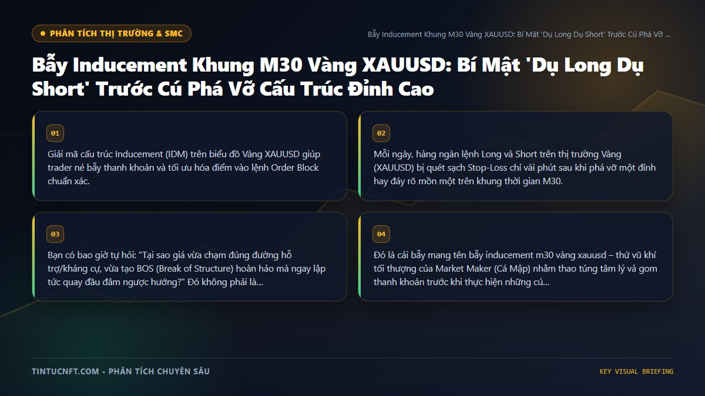
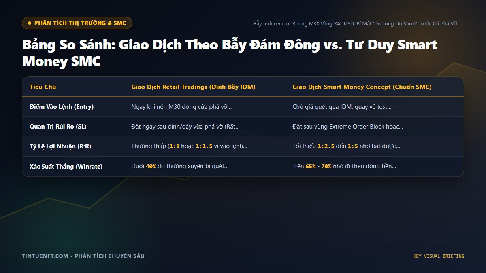

## Bẫy Inducement Khung M30 Vàng XAUUSD: Bí Mật 'Dụ Long Dụ Short' Trước Cú Phá Vỡ Cấu Trúc Đỉnh Cao


*Tổng hợp trực quan: Bẫy Inducement Khung M30 Vàng XAUUSD: Bí Mật 'Dụ Long Dụ Short' Trước Cú Phá Vỡ Cấu Trúc Đỉnh Cao*


*Giải mã cấu trúc Inducement (IDM) trên biểu đồ Vàng XAUUSD giúp trader né bẫy thanh khoản và tối ưu hóa điểm vào lệnh Order Block chuẩn xác.*

---

Mỗi ngày, hàng ngàn lệnh Long và Short trên thị trường Vàng (XAUUSD) bị quét sạch Stop-Loss chỉ vài phút sau khi phá vỡ một đỉnh hay đáy rõ mồn một trên khung thời gian M30. Bạn có bao giờ tự hỏi: *"Tại sao giá vừa chạm đúng đường hỗ trợ/kháng cự, vừa tạo BOS (Break of Structure) hoàn hảo mà ngay lập tức quay đầu đâm ngược hướng?"* 

Đó không phải là sự ngẫu nhiên hay xui xẻo. Đó là cái bẫy mang tên **bẫy inducement m30 vàng xauusd** – thứ vũ khí tối thượng của Market Maker (Cá Mập) nhằm thao túng tâm lý và gom thanh khoản trước khi thực hiện những cú đẩy giá thật sự. Dưới lăng kính Smart Money Concept (SMC) và Volume Spread Analysis (VSA), chúng ta sẽ lột trần thủ đoạn này.

---

## 1. Bản Chất Của Inducement (IDM): Vùng Mồi Nhử Thanh Khoản Hoàn Hảo

Trong cấu trúc thị trường, Inducement (viết tắt là IDM) được hiểu là vùng thanh khoản phụ mà Smart Maker giăng ra để dụ dỗ các nhà giao dịch bán lẻ (Retail Traders) nhảy vào thị trường trước khi giá chính thức chạm đến vùng Order Block (OB) hoặc Mitigation Block thực sự.

### Sự Thật Phũ Phàng Về Tâm Lý Giao Dịch M30
Khung thời gian M30 (30 phút) là chiến trường khốc liệt nhất đối với các day-trader vàng. Tại đây, tâm lý FOMO đạt đỉnh khi các mô hình giá kinh điển như "phá vỡ đỉnh cũ", "test hỗ trợ" xuất hiện liên tục. Cá Mập hiểu rõ điều này. Họ cố tình tạo ra một cấu trúc giả để:
- Dụ phe **Breakout Traders** nhảy vào mua đuổi (Buy Stop) khi thấy giá vượt kháng cự.
- Dụ phe **Support/Resistance Traders** đặt lệnh bán (Sell Stop) khi thấy giá phá vỡ đáy cũ.

> 💡 **Lưu ý thực chiến:** Inducement luôn nằm trước một Order Block chất lượng cao. Nếu không có IDM, vùng Order Block đó rất dễ bị phá thủng bởi vì Smart Money chưa gom đủ khối lượng lệnh đối ứng (Liquidity) để đẩy giá đi xa.

---

## 2. Nhận Diện Bẫy Inducement Khung M30 Vàng XAUUSD Bằng SMC & VSA

Để không bao giờ dính bẫy thanh khoản của Smart Money, bạn cần tư duy như một nhà tạo lập thị trường thay vì hành động theo cảm tính của đám đông.

### Quy Trình 4 Bước Bắt Bài Inducement Trên XAUUSD M30

1. **Xác định xu hướng chủ đạo (HTF - Higher Timeframe):** Luôn xem khung H1 và H4 để biết xu hướng lớn đang là gì (Bullish hay Bearish). Không bao giờ giao dịch ngược xu hướng lớn trên M30.
2. **Quan sát cú quét thanh khoản (Liquidity Sweep):** Khi giá tạo một cấu trúc tăng (HH - HL), đỉnh gần nhất thường xuất hiện một nhịp hồi nhỏ tạo ra IDM. Đó chính là vùng mồi nhử.
3. **Xác định vùng Order Block thực sự (True OB):** Phải là nến giảm cuối cùng trước đợt tăng mạnh (trong xu hướng tăng) và có kèm theo sự mất cân bằng giá - **Fair Value Gap (FVG)**.
4. **Kiểm tra khối lượng (VSA):** Tại cây nến quét qua IDM, khối lượng giao dịch thường đột biến nhưng biên độ nến hẹp hoặc để lại râu nến dài (Stopping Volume / Up-Thrust), cho thấy phe cá mập đang hấp thụ lệnh.

---

## 3. Bảng So Sánh: Giao Dịch Theo Bẫy Đám Đông vs. Tư Duy Smart Money SMC


*Tổng hợp trực quan: 3. Bảng So Sánh: Giao Dịch Theo Bẫy Đám Đông vs. Tư Duy Smart Money SMC*


| Tiêu Chú | Giao Dịch Retail Tradings (Dính Bẫy IDM) | Giao Dịch Smart Money Concept (Chuẩn SMC) |
| :--- | :--- | :--- |
| **Điểm Vào Lệnh (Entry)** | Ngay khi nến M30 đóng cửa phá vỡ đỉnh/đáy (Breakout). | Chờ giá quét qua IDM, quay về test Order Block + FVG. |
| **Quản Trị Rủi Ro (SL)** | Đặt ngay sau đỉnh/đáy vừa phá vỡ (Rất dễ dính râu nến quét). | Đặt sau vùng Extreme Order Block hoặc qua swing structure an toàn. |
| **Tỷ Lệ Lợi Nhuận (R:R)** | Thường thấp (1:1 hoặc 1:1.5 vì vào lệnh muộn). | Tối thiểu **1:2.5 đến 1:5** nhờ bắt được gốc sóng. |
| **Xác Suất Thắng (Winrate)** | Dưới 40% do thường xuyên bị quét Stop-Loss (Sweep). | Trên 65% - 70% nhờ đi theo dòng tiền lớn. |

---

## 4. Thiết Lập Chiến Lược Giao Dịch XAUUSD M30 Tối Ưu Tỷ Lệ R:R 1:3

Khi đã nắm thóp được cách vận hành của **bẫy inducement m30 vàng xauusd**, bạn có thể thiết lập một kế hoạch giao dịch hoàn hảo với tỷ lệ Risk:Reward vượt trội.

### Thông Số Thiết Lập Lệnh Mẫu (Setup Chuẩn SMC)

* **Cặp tiền:** XAUUSD (Vàng)
* **Khung thời gian:** M30 (Entry) kết hợp H1 (Structure)
* **Điểm vào lệnh (Entry):** Tại vùng **Extreme Order Block** sau khi IDM đã bị quét sạch (Swept).
* **Cắt lỗ (Stop-Loss):** Cách râu nến của Order Block từ **3 đến 5 pips** (tránh bị quét nhiễu).
* **Chốt lời (Take-Profit):** Tại vùng thanh khoản đối diện (Buy-side Liquidity hoặc Sell-side Liquidity ở khung cao hơn), đảm bảo R:R tối thiểu **1:2.5**.

```
[Xu hướng M30] ---> Tạo Đỉnh/Đáy giả (IDM) ---> Quét IDM (Trap) ---> Chạm True Order Block + FVG ---> Phá Cấu Trúc (BOS / CHoCH) ---> Entry 🚀
```

> 💡 **Lưu ý thực chiến:** Không đặt lệnh limit chờ sẵn tại Order Block nếu chưa thấy dấu hiệu giá quét qua Inducement. Sự kiên nhẫn chờ đợi "cú lừa" của thị trường chính là chìa khóa phân định giữa Trader thua lỗ và Pro Trader.

---

## ⚡ Theo Dõi Tín Hiệu Giao Dịch & Nhận Định SMC Real-time

Đừng để những cú quét râu nến bất ngờ lấy đi nguồn vốn của bạn:

- 📊 **Khung Tín Hiệu Sống Real-time:** Truy cập [Trading Signal VIP](https://tintucnft.com/trading-signal-vip) để theo dõi các vị thế Vàng & Crypto cập nhật từng phút.
- 🤖 **Kiểm Chứng Hiệu Suất Bot EA Myfxbook:** Truy cập ngay  [Bot EA MT5 (https://tintucnft.com)](https://tintucnft.com/bot-ea-trading) để xem track record thực tế với Max Drawdown dưới 10%.
- ✈️ **Cập Nhật Tín Hiệu & Chiến Lược Mỗi Ngày:** Tham gia ngay [Kênh Telegram MCG Community](https://t.me/channelmcg) để không bỏ lỡ các cảnh báo thị trường khẩn cấp.
- 💬 **Điều Kiện Tham Gia Nhóm Tín Hiệu:** [Liên Hệ Admin Hỗ Trợ (@willrich)](https://t.me/willrich) để được tư vấn kích hoạt tài khoản đối tác chuẩn quốc tế.