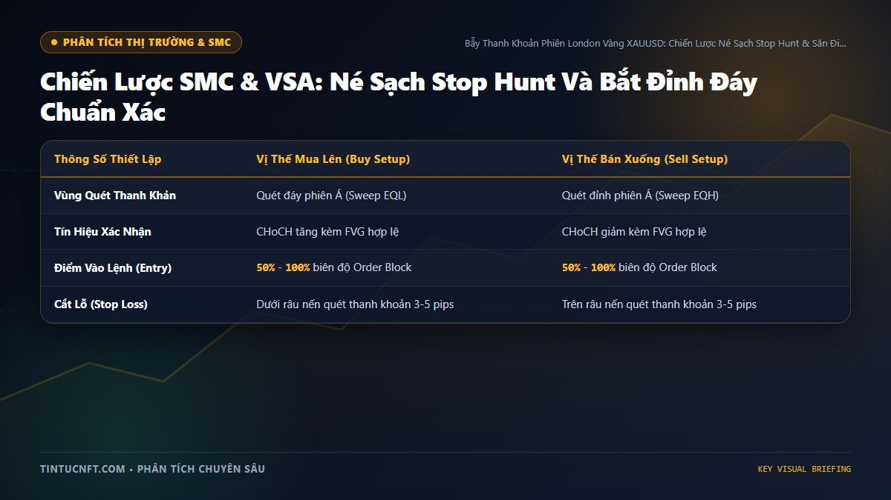

## Giải Mã Cơn Ác Mộng "Stop Hunt" Đầu Phiên London

*Cận cảnh mặt đồng hồ mang sắc xanh đặc trưng, đánh dấu thời điểm mở cửa phiên giao dịch London nhiều biến động.*

Mỗi khi kim đồng hồ điểm 15:00 giờ Việt Nam (bắt đầu phiên London), hàng ngàn trader giao dịch XAUUSD lại rơi vào một kịch bản quen thuộc: Giá bỗng nhiên phi nước đại phá thủng đỉnh hoặc đáy cũ của phiên Á, tạo tín hiệu **Breakout** vô cùng uy tín. Bạn hưng phấn vào lệnh đuổi hoặc đặt lệnh chờ tại **Order Block**. Nhưng chỉ 5 phút sau, một cây nến rút râu (wick) bạo lực quét sạch **Stop Loss** của bạn trước khi đảo chiều đi đúng hướng phân tích ban đầu. 

Đó không phải là sự ngẫu nhiên của thị trường, mà là nghệ thuật thao túng dòng tiền kinh điển của Smart Money. Việc không thấu hiểu cách thị trường vận hành thanh khoản khiến bạn mãi là nạn nhân của những cú quét Stop Hunt. Bài viết này từ Smart Trader VIP sẽ mổ xẻ tận gốc tư duy tạo lập thị trường, giúp bạn biến **bẫy thanh khoản phiên london vàng xauusd** thành cơ hội vàng để tối ưu hóa tỷ lệ R:R vượt ngưỡng 1:2.5.

---

## Bản Chất Của Bẫy Thanh Khoản Phiên London (Stop Hunt)

### Dòng Tiền Tổ Chức Và Thanh Khoản Bán Lẻ (Retail Liquidity)
Thị trường vàng toàn cầu (XAUUSD) được điều tiết bởi các Market Maker (MM) – những ngân hàng trung ương, quỹ đầu cơ lớn với khối lượng lệnh khổng lồ. Họ không thể khớp một lượng lệnh hàng tỷ USD mà không làm trượt giá (slippage). Do đó, họ cần một "đối thủ" để gom hoặc xả hàng, và không ai khác chính là cộng đồng trader nhỏ lẻ đặt lệnh dựa trên sách giáo khoa cơ bản.

Phiên Á thường là vùng đi ngang (consolidation) hoặc tích lũy biên độ hẹp. Tại đây, trader nhỏ lẻ liên tục thiết lập các ngưỡng kháng cự/hỗ trợ truyền thống, đồng thời đặt Stop Loss ngay phía trên đỉnh hoặc phía dưới đáy cũ. Đây chính là "kho thanh khoản" khổng lồ mà Smart Money nhắm tới.

### Cơ Chế Kích Hoạt Vẫy Vùng BOS Và CHoCH Giả
Trước khi xu hướng chính của phiên London hoặc New York diễn ra, Market Maker thường thực hiện thao tác **Liquidity Sweep** (Quét thanh khoản). 
* Giá tạo một cú **Break of Structure (BOS)** giả qua khỏi biên độ phiên Á.
* Kích hoạt tâm lý FOMO của phe mua đuổi (Buy Stop) hoặc dính đạn Stop Loss của phe bán trước đó.
* Ngay sau khi gom đủ thanh khoản (nhiên liệu), thuật toán của họ lập tức đảo chiều mạnh mẽ, tạo ra cú **Change of Character (CHoCH)** xác nhận sự lật đổ cấu trúc cục bộ.

> 💡 **Lưu ý thực chiến:** Đừng bao giờ giao dịch breakout phiên Á bằng mắt thường. 90% các cú phá vỡ (breakout) đầu phiên London đều là bẫy thanh khoản nếu không đi kèm với sự bùng nổ của khối lượng giao dịch (Volume Spread Analysis).

---

## Chiến Lược SMC & VSA: Né Sạch Stop Hunt Và Bắt Đỉnh Đáy Chuẩn Xác

*Tổng hợp trực quan: Chiến Lược SMC & VSA: Né Sạch Stop Hunt Và Bắt Đỉnh Đáy Chuẩn Xác*

Để tồn tại và chiến thắng trong thị trường vàng khốc liệt này, bạn cần tư duy ngược lại với đám đông. Dưới đây là hệ thống chiến lược 4 bước kết hợp Smart Money Concept và Volume Spread Analysis.

### Bước 1: Định Vị Vùng "Bẫy Tiềm Năng" (Inducement - IDD)
Trước khi phiên London khai màn (khoảng 14:00 - 14:45 VN), hãy đánh dấu biên độ cao nhất và thấp nhất của phiên Á. Quan sát các vùng tích lũy thanh khoản kép (Equal Highs - EQH hoặc Equal Lows - EQL). Đó chính là bẫy hoàn hảo mà Smart Money đang giăng sẵn.

### Bước 2: Chờ Xác Nhận Cú Quét Thanh Khản (Liquidity Sweep)
Hãy kiên nhẫn ngồi ngoài khi giá bắt đầu quét qua đỉnh hoặc đáy phiên Á. Điểm mấu chốt để nhận diện đây là một cú **Stop Hunt** thực sự chứ không phải xu hướng thật sự nằm ở Volume (Khối lượng giao dịch) trên khung M5 hoặc M15:
* Giá vượt đỉnh phiên Á nhưng nến đóng cửa lại thụt đầu xuống nhanh chóng, kèm theo một râu nến dài (Long Wick).
* Khối lượng giao dịch (Volume) tăng vọt tại vùng râu nến cho thấy sự tham gia của lệnh tổ chức nhưng đồng thời cũng là dấu hiệu hấp thụ lệnh bán/mua của đám đông.

### Bước 3: Tìm Kiếm Điểm Đảo Chiều Với Order Block (OB) và FVG
Ngay sau cú quét thanh khoản, giá sẽ tạo ra một cú **CHoCH** (Change of Character) phá vỡ cấu trúc ngắn hạn gần nhất theo hướng ngược lại. 
* Tìm kiếm một **Order Block (OB)** hoặc **Fair Value Gap (FVG)** hợp lệ được hình thành ngay tại thời điểm tạo CHoCH.
* Đây là vùng để lại dấu chân của tổ chức tài chính – nơi họ bắt đầu đẩy lệnh mạnh mẽ theo xu hướng thật.

### Bước 4: Thiết Lập Quản Trị Vốn Và Tỷ Lệ R:R Tối Thiểu 1:2.5

Để vượt qua các vòng quỹ khắt khe như FTMO, MFF hay quản lý tài khoản cá nhân bền vững, việc tuân thủ tỷ lệ Risk:Reward là tôn chỉ sống còn.

| Thông Số Thiết Lập | Vị Thế Mua Lên (Buy Setup) | Vị Thế Bán Xuống (Sell Setup) |
| :--- | :--- | :--- |
| **Vùng Quét Thanh Khản** | Quét đáy phiên Á (Sweep EQL) | Quét đỉnh phiên Á (Sweep EQH) |
| **Tín Hiệu Xác Nhận** | CHoCH tăng kèm FVG hợp lệ | CHoCH giảm kèm FVG hợp lệ |
| **Điểm Vào Lệnh (Entry)** | 50% - 100% biên độ Order Block | 50% - 100% biên độ Order Block |
| **Cắt Lỗ (Stop Loss)** | Dưới râu nến quét thanh khoản 3-5 pips | Trên râu nến quét thanh khoản 3-5 pips |
| **Chốt Lời (Take Profit)** | Thanh khoản đối diện (EQH / liquidity pool) | Thanh khoản đối diện (EQL / liquidity pool) |
| **Tỷ Lệ R:R Mục Tiêu** | Tối thiểu **1:2.5** đến **1:4** | Tối thiểu **1:2.5** đến **1:4** |

---

## Bảng So Sánh Hiệu Suất: Giao Dịch Truyền Thống Vs. Hệ Thống SMC Smart Trader VIP

| Tiêu Chí Đánh Giá | Giao Dịch Theo Kháng Cự/Hỗ Trợ Cũ | Chiến Lược SMC & VSA Chuẩn Smart Trader VIP |
| :--- | :--- | :--- |
| **Tỷ lệ Winrate trung bình** | 35% - 40% | 60% - 68% |
| **Tỷ lệ Risk:Reward (R:R)** | Thường xuyên dưới 1:1.5 | Duy trì tối thiểu **1:2.5 đến 1:4** |
| **Khả năng dính Stop Hunt** | Rất cao (trên 70% các dịp phiên London) | Giảm thiểu dưới 15% nhờ xác định IDD |
| **Phù hợp thi quỹ (FTMO/MFF)** | Dễ cháy tài khoản do Drawdown lớn | Tối ưu hóa quản trị vốn, kiểm soát Drawdown < 8% |

---

## Lời Kết: Chuyển Hóa Nghịch Cảnh Thành Lợi Thế Giao Dịch

Thị trường tài chính không có chỗ cho cảm xúc và sự phỏng đoán ngây thơ. Những cú quét Stop Hunt phiên London thực chất là chiếc la bàn rõ ràng nhất chỉ ra nơi dòng tiền lớn đang ẩn náu. Bằng cách áp dụng triệt để tư duy Smart Money Concept – kiên nhẫn chờ đợi bẫy thanh khoản hình thành, xác nhận cấu trúc CHoCH và bám sát các vùng Order Block chuẩn xác, bạn hoàn toàn có thể làm chủ cuộc chơi và đạt tỷ lệ R:R vượt trội.

---
## ⚡ Theo Dõi Tín Hiệu Giao Dịch & Nhận Định SMC Real-time

Đừng để những cú quét râu nến bất ngờ lấy đi nguồn vốn của bạn:

- 📊 **Khung Tín Hiệu Sống Real-time:** Truy cập [Trading Signal VIP (https://tintucnft.com)](https://tintucnft.com/trading-signal-vip) để theo dõi các vị thế Vàng & Crypto cập nhật từng phút.
- 🤖 **Kiểm Chứng Hiệu Suất Bot EA Myfxbook:** Truy cập ngay  [Bot EA MT5 (https://tintucnft.com)](https://tintucnft.com/bot-ea-trading) để xem track record thực tế với Max Drawdown dưới 10%.
- ✈️ **Cập Nhật Tín Hiệu & Chiến Lược Mỗi Ngày:** Tham gia ngay [Kênh Telegram MCG Community](https://t.me/channelmcg) để không bỏ lỡ các cảnh báo thị trường khẩn cấp.
- 💬 **Điều Kiện Tham Gia Nhóm Tín Hiệu:** [Liên Hệ Admin Hỗ Trợ (@willrich)](https://t.me/willrich) để được tư vấn kích hoạt tài khoản đối tác chuẩn quốc tế.