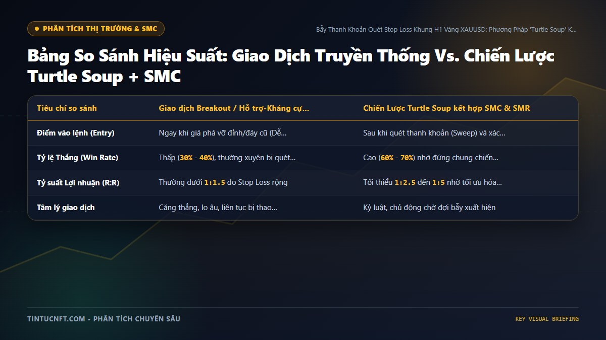

Đã bao giờ bạn tự hỏi tại sao lệnh Buy của mình vừa khớp tại hỗ trợ khung H1, hay lệnh Sell vừa chạm đỉnh cũ, thì ngay lập tức xuất hiện một cây nến quét râu (Stop Hunt) mạnh mẽ hất văng toàn bộ vị thế, trước khi thị trường đảo chiều chính xác theo đúng phân tích ban đầu? Đó không phải là ngẫu nhiên, cũng không phải rủi ro thông thường. Đó chính là cái bẫy thanh khoản hoàn hảo được giăng sẵn bởi Market Maker (Smart Money).

Hiện tượng **bẫy thanh khoản quét stop loss vàng xauusd** trên khung H1 đang là cơn ác mộng của hàng ngàn trader giao dịch theo trường phái phân tích kỹ thuật truyền thống. Khi đám đông đồng thuận nhìn thấy một mô hình, đó chính là lúc Smart Money gom hàng.

---

## 1. Giải Mã Bản Chất Vấn Đề: Tại Sao Trader Liên Tục Mắc Bẫy Stop Hunt Khung H1 Vàng?

*Vàng thỏi, đồng Bitcoin và ổ khóa tượng trưng cho thanh khoản và các bẫy giá trên thị trường tài chính.*

Thị trường tài chính, đặc biệt là vàng (XAUUSD), hoạt động dựa trên thanh khoản (Liquidity). Để các tổ chức tài chính lớn hoặc ngân hàng trung ương có thể khớp những khối lượng lệnh khổng lồ (Institutional Order Block), họ cần một lượng lớn các lệnh chờ khớp (Buy Stop/Sell Stop) hoặc điểm dừng lỗ (Stop Loss) của nhà đầu tư nhỏ lẻ làm mồi nhử.

### Nghịch lý hạ tầng thanh khoản trên XAUUSD
- **Bẫy mô hình giá:** Đám đông thường đặt lệnh Breakout khi giá phá vỡ đỉnh/đáy Á (Asian Session High/Low) hoặc đường xu hướng (Trendline). 
- **Cơn khát thanh khoản của Market Maker:** Các vùng **Buy-side Liquidity (BSL)** và **Sell-side Liquidity (SSL)** nằm ngay phía trên các đỉnh cũ và dưới các đáy cũ khung H1 chính là "nhiên liệu" để Smart Money thực hiện các cú quét (Sweep).
- **Hệ quả tất yếu:** Trader liên tục bị quét dừng lỗ oan ức, tâm lý hoang mang xuất hiện, dẫn đến việc nhồi lệnh (revenge trading) và nhanh chóng cháy tài khoản chỉ trong vài phiên giao dịch.

> 💡 **Lưu ý thực chiến:** Market Maker không quan tâm bạn phân tích giỏi đến đâu. Họ chỉ quan tâm tiền của bạn đang nằm ở đâu trên biểu đồ H1. Nếu bạn đặt Stop Loss ngay sau đỉnh/đáy hiển thị rõ mồn một, bạn đang tự biến mình thành thanh khoản cho cá mập.

---

## 2. Chiến Lược "Turtle Soup" Kết Hợp SMR (Smart Money Reversal): Kỹ Thuật Né Sạch Lệnh Dụ

Để sống sót và chiến thắng trong môi trường cá lớn nuốt cá bé này, chúng ta cần vận dụng sự kết hợp đỉnh cao giữa phương pháp **Turtle Soup** (săn lệnh breakout giả) và **SMR (Smart Money Reversal)** dưới lăng kính Volume Spread Analysis (VSA).

### Bước 1: Xác Định Vùng Thanh Khoản Mục Tiêu (Liquidity Pool)
Quan sát biểu đồ H1 của XAUUSD, đánh dấu các vùng:
- **Asian High / Asian Low** hoặc **London Session High / Low**.
- Các đỉnh bằng nhau (Equal Highs - EQH) hoặc đáy bằng nhau (Equal Lows - EQL). Đây là nam châm hút giá.

### Bước 2: Chờ Đợi Cú Quét Thanh Khoản (Liquidity Sweep)
Không vội vàng vào lệnh khi giá vừa chạm đỉnh/đáy. Hãy kiên nhẫn quan sát cách giá phản ứng:
- Giá đẩy xuyên qua đỉnh cũ H1 (ví dụ: quét qua mức $2380), tạo ra sự phấn khích cho các trader vào lệnh mua Breakout.
- Tuy nhiên, đây là **False Breakout (Breakout giả)**. Thanh khoản đã được gom sạch.

### Bước 3: Xác Nhận Tín Hiệu Đảo Chiều Thông Minh (SMR & BOS)
Ngay sau cú quét râu (Sweep), dòng tiền thông minh để lại dấu chân qua các tín hiệu VSA và SMC:
- **CHoCH (Change of Character):** Xu hướng khung H1 thay đổi cấu trúc đột ngột, giá phá vỡ cấu trúc giảm/tăng gần nhất kèm theo một cây nến biên độ rộng (Wide Spread Candle) với khối lượng giao dịch đột biến (High Volume).
- **Order Block (OB) hoặc Fair Value Gap (FVG):** Xác định vùng mất cân bằng cung cầu xuất hiện ngay sau cú CHoCH. Đây chính là trạm dừng chân để đặt lệnh Entry chuẩn xác.

---

## 3. Bảng So Sánh Hiệu Suất: Giao Dịch Truyền Thống Vs. Chiến Lược Turtle Soup + SMC

*Tổng hợp trực quan: 3. Bảng So Sánh Hiệu Suất: Giao Dịch Truyền Thống Vs. Chiến Lược Turtle Soup + SMC*

| Tiêu chí so sánh | Giao dịch Breakout / Hỗ trợ-Kháng cự truyền thống | Chiến Lược Turtle Soup kết hợp SMC & SMR |
| :--- | :--- | :--- |
| **Điểm vào lệnh (Entry)** | Ngay khi giá phá vỡ đỉnh/đáy cũ (Dễ dính bẫy) | Sau khi quét thanh khoản (Sweep) và xác nhận SMR |
| **Tỷ lệ Thắng (Win Rate)** | Thấp (30% - 40%), thường xuyên bị quét Stop Loss | Cao (60% - 70%) nhờ đứng chung chiến tuyến với Market Maker |
| **Tỷ suất Lợi nhuận (R:R)** | Thường dưới 1:1.5 do Stop Loss rộng | Tối thiểu **1:2.5 đến 1:5** nhờ tối ưu hóa vùng FVG/OB |
| **Tâm lý giao dịch** | Căng thẳng, lo âu, liên tục bị thao túng tâm lý | Kỷ luật, chủ động chờ đợi bẫy xuất hiện |

---

## 4. Thiết Lập Thông Số Giao Dịch Vàng XAUUSD Khung H1 (Setup Chuẩn R:R > 1:2.5)

Dưới đây là bảng thông số thiết lập một lệnh Sell điển hình sau khi quét bẫy thanh khoản ở đỉnh khung H1:

| Thông số chiến lược | Mức giá / Vùng giá tham chiếu | Giải thích kỹ thuật SMC |
| :--- | :--- | :--- |
| **Cấu trúc bẫy** | Quét qua đỉnh H1 ($2385.00) | Lệnh Buy Stop của đám đông bị khớp và dính Stop Loss |
| **Dấu chân Smart Money** | CHoCH giảm giá mạnh về $2370.00 | Thể hiện sự tham gia của tổ chức tài chính bán xuống |
| **Vùng Vào Lệnh (Entry)** | **$2378.00 - $2380.00** | Vùng **Order Block (OB)** hoặc **Fair Value Gap (FVG)** khung H1 |
| **Dừng Lỗ (Stop Loss)** | **$2387.00** | Đặt an toàn ngay phía trên râu nến quét thanh khoản |
| **Chốt Lời (Take Profit)** | TP1: **$2360.00** / TP2: **$2345.00** | Vùng thanh khoản đối diện (Sell-side Liquidity) |
| **Tỷ lệ Risk:Reward** | **1:2.8 đến 1:4.2** | Đảm bảo tiêu chuẩn quản trị vốn chuyên nghiệp |

---

## 5. Kết Luận

Giao dịch vàng XAUUSD trên khung H1 không dành cho sự vội vã. Hiểu được bản chất của **bẫy thanh khoản quét stop loss vàng xauusd** giúp bạn chuyển hóa từ vị thế của một "con mồi" thành người quan sát dòng tiền thông minh. Bằng cách áp dụng mô hình Turtle Soup kết hợp cấu trúc SMC và SMR, bạn sẽ luôn đi sau một bước so với đám đông nhưng lại đi trước một bước so với biến động giá thực tế.

---

## ⚡ Theo Dõi Tín Hiệu Giao Dịch & Nhận Định SMC Real-time

Đừng để những cú quét râu nến bất ngờ lấy đi nguồn vốn của bạn:

- 📊 **Khung Tín Hiệu Sống Real-time:** Truy cập [Trading Signal VIP (https://tintucnft.com)](https://tintucnft.com/trading-signal-vip) để theo dõi các vị thế Vàng & Crypto cập nhật từng phút.
- 🤖 **Kiểm Chứng Hiệu Suất Bot EA Myfxbook:** Truy cập ngay  [Bot EA MT5 (https://tintucnft.com)](https://tintucnft.com/bot-ea-trading) để xem track record thực tế với Max Drawdown dưới 10%.
- ✈️ **Cập Nhật Tín Hiệu & Chiến Lược Mỗi Ngày:** Tham gia ngay [Kênh Telegram MCG Community](https://t.me/channelmcg) để không bỏ lỡ các cảnh báo thị trường khẩn cấp.
- 💬 **Điều Kiện Tham Gia Nhóm Tín Hiệu:** [Liên Hệ Admin Hỗ Trợ (@willrich)](https://t.me/willrich) để được tư vấn kích hoạt tài khoản đối tác chuẩn quốc tế.