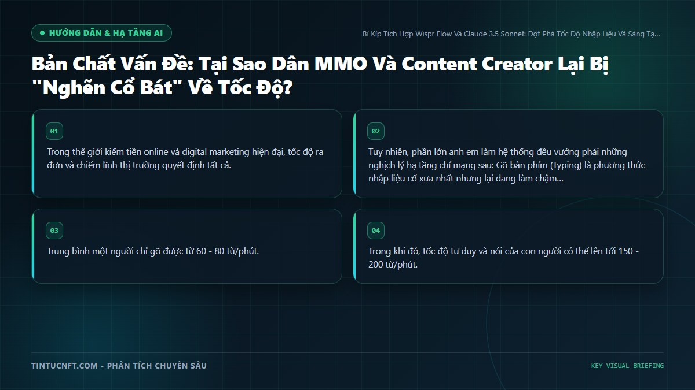
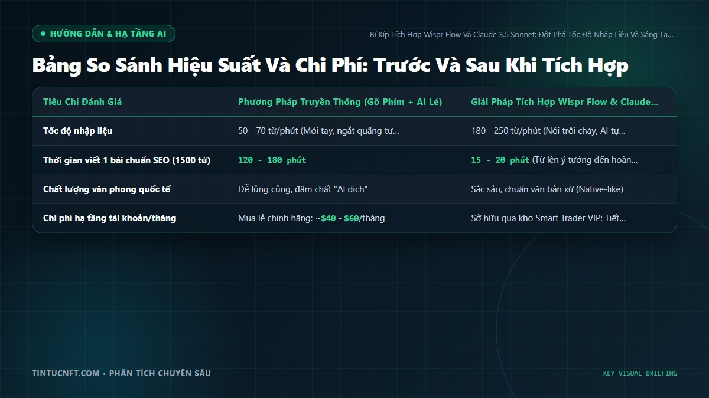

Anh em làm MMO, chạy chiến dịch marketing quốc tế hay xây dựng hệ thống content scale toàn cầu chắc chắn đã quá quen thuộc với cảnh tượng này: Ngồi trước màn hình từ sáng đến tối, mỏi nhừ cổ tay, lưng còng xuống vì gõ phím liên tục. Việc phải biên tập hàng chục bài viết chuẩn SEO, lên kịch bản video ngắn bằng tiếng Anh hay viết hàng trăm mẫu copywriting mỗi ngày đang vắt kiệt sức lực của những "bộ óc" tư duy chiến lược. Tốc độ gõ bàn phím cơ dẫu có nhanh đến đâu cũng không thể theo kịp tốc độ nảy số của tư duy, chưa kể rào cản ngôn ngữ khiến năng suất bị bóp nghẹt. 

Đó là lúc anh em cần đến sự giao thoa của hai công nghệ tối tân nhất hiện nay: **tích hợp wispr flow và claude 3.5 sonnet**. Đây không đơn thuần là một mẹo vặt năng suất, mà là một cuộc cách mạng về hạ tầng nhập liệu và xử lý ngôn ngữ, giúp giải phóng hoàn toàn đôi tay và tối ưu hóa năng lực sáng tạo nội dung X10 lần.

## Bản Chất Vấn Đề: Tại Sao Dân MMO Và Content Creator Lại Bị "Nghẽn Cổ Bát" Về Tốc Độ?

*Tổng hợp trực quan: Bản Chất Vấn Đề: Tại Sao Dân MMO Và Content Creator Lại Bị "Nghẽn Cổ Bát" Về Tốc Độ?*

Trong thế giới kiếm tiền online và digital marketing hiện đại, tốc độ ra đơn và chiếm lĩnh thị trường quyết định tất cả. Tuy nhiên, phần lớn anh em làm hệ thống đều vướng phải những nghịch lý hạ tầng chí mạng sau:

### 1. Nút Thắt Cổ Chai Từ Tốc Độ Nhập Liệu Truyền Thống
Gõ bàn phím (Typing) là phương thức nhập liệu cổ xưa nhất nhưng lại đang làm chậm toàn bộ quy trình tự động hóa tư duy. Trung bình một người chỉ gõ được từ 60 - 80 từ/phút. Trong khi đó, tốc độ tư duy và nói của con người có thể lên tới 150 - 200 từ/phút. Việc phải dịch chuyển ý tưởng từ não bộ -> gõ phím -> sửa lỗi chính tả -> định hình câu chữ làm đứt gãy mạch cảm xúc và tiêu hao năng lượng thần kinh cực lớn.

### 2. Sự Hạn Chế Của Các Công Cụ Nhập Liệu Giọng Nói Phổ Thông
Nhiều anh em đã thử qua các công cụ chuyển đổi giọng nói thành văn bản (Speech-to-text) thông dụng. Kết quả nhận lại là gì? Sai chính tả la liệt, không hiểu ngữ cảnh chuyên ngành MMO/Crypto/Marketing, và đặc biệt là không thể tự động loại bỏ các từ đệm, lắp bắp ("à", "ừ", "thì"). Văn bản thô thu được thậm chí còn mất nhiều thời gian biên tập hơn là tự gõ từ đầu.

### 3. Chi Phí Vận Hành Tài Khoản Bản Quyền Đắt Đỏ
Để tạo ra nội dung chất lượng cao phục vụ thị trường quốc tế, anh em buộc phải sử dụng các dòng siêu AI mạnh nhất hiện nay như Claude 3.5 Sonnet. Tuy nhiên, việc mua lẻ từng tài khoản chính hãng với mức giá niêm yết trên thị trường khiến chi phí "burn" vào hạ tầng mỗi tháng đội lên đáng kể, làm mòn biên lợi nhuận của các chiến dịch MMO.

> 💡 **Lưu ý thực chiến:** Đừng bao giờ dùng các giải pháp miễn phí hoặc công cụ trôi nổi kém chất lượng. Hạ tầng AI và công cụ nhập liệu là vũ khí chiến lược; đầu tư sai chỗ, anh em vừa mất tiền, vừa lộ dữ liệu chiến dịch vào tay bên thứ ba.

---

## Giải Pháp Đột Phá: Quy Trình Tích Hợp Wispr Flow Và Claude 3.5 Sonnet X10 Năng Suất

Để giải quyết triệt để bài toán mỏi cổ tay và tốc độ sản xuất content, hệ thống hạ tầng của Smart Trader VIP đề xuất quy trình khép kín kết hợp giữa **Wispr Flow** (công cụ nhập liệu giọng nói bằng AI đỉnh cao cho phép nói tự nhiên, tự động sửa lỗi và định dạng) và **Claude 3.5 Sonnet** (siêu AI phân tích và biên tập ngôn ngữ sắc bén nhất hành tinh).

### Bước 1: Thiết Lập Wispr Flow Làm Cổng Nhập Liệu Giọng Nói Tốc Độ Cao
Wispr Flow hoạt động như một tầng middleware thông minh nằm giữa giọng nói của bạn và mọi ứng dụng trên máy tính. 
- Thay vì gõ phím, anh em chỉ cần bật tổ hợp phím tắt của Wispr Flow và đọc suy nghĩ của mình bằng giọng nói tự nhiên (tiếng Anh hoặc tiếng Việt đều cực kỳ mượt mà).
- Thuật toán AI của Wispr Flow tự động loại bỏ các từ thừa, hiểu dấu câu, định dạng đoạn văn bản theo đúng ý muốn và bơm thẳng văn bản sạch vào màn hình ứng dụng với tốc độ nhanh gấp 5 lần gõ phím thông thường.

### Bước 2: Bắn Dữ Liệu Thô Vào Claude 3.5 Sonnet Để Tinh Chỉnh & Mở Rộng
Ngay sau khi dòng suy nghĩ thô được nạp bằng giọng nói, anh em hãy đưa trực tiếp vào **Claude 3.5 Sonnet** thông qua các câu lệnh (Prompt) tối ưu sẵn. 
- Claude 3.5 Sonnet sở hữu khả năng thấu hiểu ngữ cảnh sâu sắc (Context Window lớn), tư duy logic vượt trội và phong cách hành văn tự nhiên như người bản bản xứ.
- Yêu cầu Claude chuyển đổi đoạn ý tưởng thô đó thành một bài chuẩn SEO hoàn chỉnh, một kịch bản video TikTok viral, hay một chiến dịch Email Marketing nhắm thẳng vào thị trường US/EU chỉ trong vỏn vẹn vài giây.

### Bước 3: Tự Động Hóa Workflow Với n8n Hoặc Python (Tùy Chọn Mở Rộng)
Đối với anh em làm hệ thống MMO quy mô lớn, có thể tích hợp API của Wispr Flow và Claude thông qua các luồng n8n tự động hóa. Đọc kịch bản bằng giọng nói -> Claude tự động phân rã thành 10 biến thể content khác nhau -> Đẩy thẳng lên các trang mạng xã hội hoặc hệ thống blog qua API mà không cần chạm tay vào chuột.

---

## Bảng So Sánh Hiệu Suất Và Chi Phí: Trước Và Sau Khi Tích Hợp

*Tổng hợp trực quan: Bảng So Sánh Hiệu Suất Và Chi Phí: Trước Và Sau Khi Tích Hợp*

Để thấy rõ giá trị kinh tế và hiệu suất làm việc mà giải pháp này mang lại, hãy nhìn vào bảng bóc tách số liệu thực tế dưới đây:

| Tiêu Chí Đánh Giá | Phương Pháp Truyền Thống (Gõ Phím + AI Lẻ) | Giải Pháp Tích Hợp Wispr Flow & Claude 3.5 Sonnet |
| :--- | :--- | :--- |
| **Tốc độ nhập liệu** | 50 - 70 từ/phút (Mỏi tay, ngắt quãng tư duy) | 180 - 250 từ/phút (Nói trôi chảy, AI tự format) |
| **Thời gian viết 1 bài chuẩn SEO (1500 từ)** | 120 - 180 phút | 15 - 20 phút (Từ lên ý tưởng đến hoàn thiện) |
| **Chất lượng văn phong quốc tế** | Dễ lủng củng, đậm chất "AI dịch" | Sắc sảo, chuẩn văn bản xứ (Native-like) |
| **Chi phí hạ tầng tài khoản/tháng** | Mua lẻ chính hãng: ~$40 - $60/tháng | Sở hữu qua kho Smart Trader VIP: Tiết kiệm 60-80% |
| **Độ bền hệ thống & Tài khoản** | Dễ lỗi, mất kết nối, gián đoạn công việc | Hạ tầng sạch, ổn định 24/7, có kỹ thuật hỗ trợ |

---

## 🌐 Kho Tài Nguyên Bản Quyền AI & Hạ Tầng MMO Tự Động Hóa

Hạ tầng sạch và công cụ bản quyền ổn định chính là nền tảng quyết định thành bại của mọi dự án MMO & Automation:

- 🛒 **Kho Tổng 84+ Công Cụ AI & Bản Quyền MMO Giá Sỉ:** Khám phá trọn bộ 6 danh mục công cụ (Siêu AI, Coding Cloud, Creative Video/Voice, VPN Sạch & Tài Khoản Số) tại [Kho AI & Hạ Tầng MMO (https://tintucnft.com)](https://tintucnft.com/kho-ai-ha-tang-mmo).
- ⚡ **Mua Hàng Tự Động 24/7:** Giao dịch nhận tài khoản/key bản quyền siêu tốc trong 30 giây qua bot Telegram: [Bot Mua Tự Động (@chatgpsplusbot)](https://t.me/chatgpsplusbot).
- 🤖 **Kiểm Chứng Hiệu Suất Bot EA Myfxbook:** Truy cập ngay  [Bot EA MT5 (https://tintucnft.com)](https://tintucnft.com/bot-ea-trading) để xem track record thực tế với Max Drawdown dưới 10%.
- 🎁 **Quà Tặng Độc Quyền (Lead Magnet):** Nhận **License GPM Login chính hãng (Tặng Key Free)** kèm bộ **Data 50+ AI Prompts & Workflows** tự động hóa: [Nhắn Tin Admin (@willrich)](https://t.me/willrich).
- ✈️ **Cập Nhật Tín Hiệu & Chiến Lược Mỗi Ngày:** Tham gia ngay [Kênh Telegram MCG Community](https://t.me/channelmcg) để không bỏ lỡ các cảnh báo thị trường khẩn cấp.