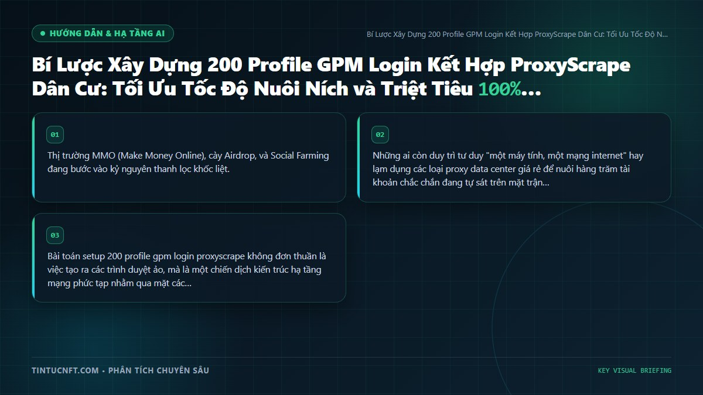
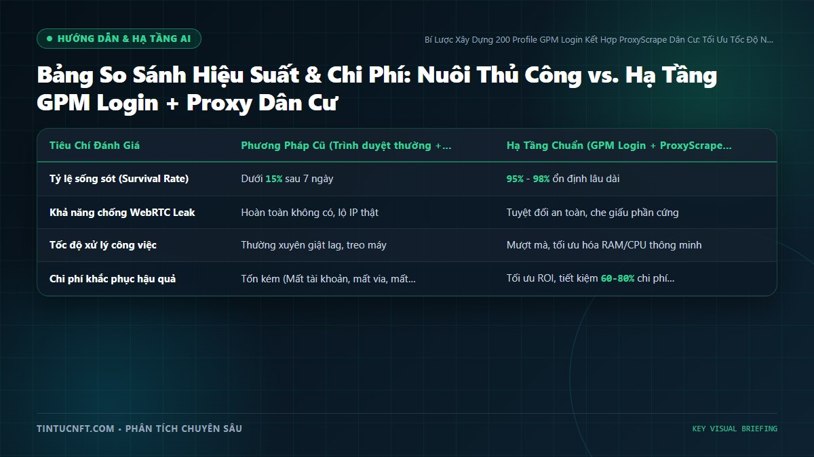

## Bí Lược Xây Dựng 200 Profile GPM Login Kết Hợp ProxyScrape Dân Cư: Tối Ưu Tốc Độ Nuôi Ních và Triệt Tiêu 100% Checkpoint Đa Nền Tảng

*Tổng hợp trực quan: Bí Lược Xây Dựng 200 Profile GPM Login Kết Hợp ProxyScrape Dân Cư: Tối Ưu Tốc Độ Nuôi Ních và Triệt Tiêu 100% Checkpoint Đa Nền Tảng*

### Quy trình thiết lập hệ thống hạ tầng Antidetect Browser và Proxy dân cư sạch giúp dân cày Airdrop & Nuôi tài khoản hàng loạt vượt mọi bộ quét an ninh.

Thị trường MMO (Make Money Online), cày Airdrop, và Social Farming đang bước vào kỷ nguyên thanh lọc khốc liệt. Những ai còn duy trì tư duy "một máy tính, một mạng internet" hay lạm dụng các loại proxy data center giá rẻ để nuôi hàng trăm tài khoản chắc chắn đang tự sát trên mặt trận kỹ thuật số. Bài toán **setup 200 profile gpm login proxyscrape** không đơn thuần là việc tạo ra các trình duyệt ảo, mà là một chiến dịch kiến trúc hạ tầng mạng phức tạp nhằm qua mặt các thuật toán AI chống gian lận (Anti-fraud AI) thế hệ mới của Facebook, Google, Twitter (X), Discord hay các nền tảng Web3 khắt khe.

---

## Bản Chất Thất Bại: Tại Sao 90% Dân MMO Bị Quét Sạch Tài Khoản?

Lý do lớn nhất khiến dàn tài khoản của bạn lăn đ Out (checkpoint, mass-ban) chỉ sau 3 đến 5 ngày hoạt động không nằm ở nội dung bạn đăng tải, mà nằm ở **Dấu vân tay kỹ thuật số (Digital Fingerprint)** và **Tọa độ mạng (IP Footprint)**. 

### Lộ WebRTC và Trùng Lặp Thông Số Phần Cứng
Khi bạn sử dụng trình duyệt thông thường hoặc các công cụ giả lập kém chất lượng, các thông số như Canvas, WebGL, AudioContext, ClientRects và đặc biệt là **WebRTC IP Leak** sẽ bị các website đọc được một cách trọn vẹn. Nếu 10 tài khoản cùng truy cập một hệ thống từ cùng một thông số phần cứng phần mềm, hệ thống an ninh sẽ lập tức đánh dấu đây là một "botnet" hoặc "dạng farm tài khoản" và tiêu diệt không thương tiếc.

### Tác Hại Của Proxy Data Center Giá Rẻ
Phần lớn người làm MMO tìm đến các loại proxy datacenter trôi nổi vì giá thành rẻ mạt. Tuy nhiên, dải IP của các nhà cung cấp datacenter này đã bị đưa vào "black-list" của hầu hết các nền tảng lớn từ lâu. Việc dùng IP datacenter để nuôi tài khoản chẳng khác nào bạn cầm biển báo "Tôi là Bot" đi qua cổng kiểm soát an ninh.

Để sống sót, bạn bắt buộc phải xây dựng một hạ tầng chuyên nghiệp, nơi **GPM Login** đóng vai trò là chiếc áo tàng hình che giấu phần cứng, kết hợp cùng **ProxyScrape dân cư (Residential Proxy)** sạch tinh khiết để ngụy trang địa điểm và nhà mạng truy cập.

---

## Giải Pháp Toàn Diện: Quy Trình Setup 200 Profile GPM Login Kết Hợp ProxyScrape Dân Cư

Để vận hành mượt mà 200 profile mà không sợ lag giật hay xung đột IP, hãy tuân thủ quy trình chuẩn thực chiến dưới đây:

### Bước 1: Chuẩn Bị Nền Tảng Hạ Tầng (Hardware & Software)
Trước khi tạo profile, hệ thống máy tính/VPS của bạn phải đủ mạnh để gánh 200 tab trình duyệt chạy ngầm (hoặc chạy xoay vòng).
*   **Cấu hình VPS/PC đề xuất:** CPU tối thiểu 8 Core / 16 Threads, RAM 32GB (đủ cấp phát 1.5GB cho mỗi cụm tab hoạt động), ổ cứng SSD NVMe tốc độ đọc ghi cao.
*   **Phần mềm:** Cài đặt phiên bản GPM Login mới nhất để tận dụng các thuật toán fake fingerprint sâu vào nhân Chromium.

### Bước 2: Thu Mua và Phân Bổ ProxyScrape Dân Cư Sạch
Sử dụng nguồn ProxyScrape loại Residential (Dân cư xoay hoặc tĩnh tùy mục đích nuôi lâu dài hay via ngắn hạn):
*   **Nguyên tắc vàng:** 1 Proxy cố định ứng với 1 Profile GPM Login (1:1). Tuyệt đối không dùng chung một IP cho nhiều tài khoản nhạy cảm.
*   Lựa chọn quốc gia IP (Geo-location) trùng khớp với ngôn ngữ và múi giờ của tài khoản bạn muốn nuôi (Ví dụ: Nuôi via US thì chọn Proxy US nhà mạng AT&T, Verizon...).

### Bước 3: Tự Động Hóa Quá Trình Tạo 200 Profile GPM Login
Thay vì tạo thủ công từng profile rất mất thời gian và dễ sai sót, hãy sử dụng tính năng **Import Profile qua file Excel/CSV** của GPM Login:
1.  Chuẩn bị file `.csv` chứa các trường dữ liệu: Tên Profile, User-Agent, Proxy (định dạng `IP:Port:Username:Password`), Timezone, WebGL, Canvas...
2.  Import trực tiếp vào phần mềm GPM Login.
3.  Thiết lập cơ chế tự động xoay đổi cookie, cache sau mỗi phiên làm việc để đảm bảo tính chân thực như người dùng thật.

> 💡 **Lưu ý thực chiến:** Khi setup hàng loạt, hãy chia 200 profile thành các nhóm nhỏ (mỗi nhóm 20-30 profile) để quản lý qua các thư mục (Folder) riêng biệt trong GPM Login. Điều này giúp bạn dễ dàng kiểm soát trạng thái tài khoản, tránh việc nhầm lẫn IP hoặc thao tác nhầm trên diện rộng.

---

## Bảng So Sánh Hiệu Suất & Chi Phí: Nuôi Thủ Công vs. Hạ Tầng GPM Login + Proxy Dân Cư

*Tổng hợp trực quan: Bảng So Sánh Hiệu Suất & Chi Phí: Nuôi Thủ Công vs. Hạ Tầng GPM Login + Proxy Dân Cư*

| Tiêu Chí Đánh Giá | Phương Pháp Cũ (Trình duyệt thường + Proxy rẻ) | Hạ Tầng Chuẩn (GPM Login + ProxyScrape Dân Cư) |
| :--- | :--- | :--- |
| **Tỷ lệ sống sót (Survival Rate)** | Dưới 15% sau 7 ngày | **95% - 98% ổn định lâu dài** |
| **Khả năng chống WebRTC Leak** | Hoàn toàn không có, lộ IP thật | **Tuyệt đối an toàn, che giấu phần cứng** |
| **Tốc độ xử lý công việc** | Thường xuyên giật lag, treo máy | Mượt mà, tối ưu hóa RAM/CPU thông minh |
| **Chi phí khắc phục hậu quả** | Tốn kém (Mất tài khoản, mất via, mất tiền mua lại) | **Tối ưu ROI, tiết kiệm 60-80% chi phí nuôi lại từ đầu** |
| **Khả năng Scale-up (Mở rộng)** | Giới hạn, dễ bị khóa toàn bộ hệ thống mạng | **Dễ dàng nâng cấp lên 500 - 1000 profile** |

---

## Tối Ưu Hóa Vận Hành và Bài Toán ROI Cho Dân MMO

Việc đầu tư vào một hệ thống hạ tầng sạch ban đầu có vẻ tốn kém, nhưng nếu tính bài toán kinh tế dài hạn, đây là khoản đầu tư sinh lời cao nhất. Khi bạn sở hữu 200 tài khoản chất lượng cao không bị checkpoint, bạn có thể:
1.  **Cày Airdrop tự động:** Đón đầu các chu kỳ phân bổ token lớn từ các dự án Layer 1, Layer 2 mà không sợ bị quét bot sybil.
2.  **Nuôi hệ thống Social Farming:** Chạy tương tác seeding, bán hàng, chạy chiến dịch marketing không giới hạn số lượng.
3.  **Tiết kiệm nhân sự:** Kết hợp GPM Login với các kịch bản Automation Python/Selenium hoặc n8n để tự động hóa 90% các tác vụ thủ công.

Tuy nhiên, việc tìm kiếm nguồn cung cấp công cụ bản quyền chính hãng, proxy dân cư tốc độ cao giá sỉ và các kịch bản tự động hóa tối ưu luôn là bài toán đau đầu với anh em tân thủ. Hiểu được nỗi đau đó, hệ thống hạ tầng của chúng tôi cung cấp giải pháp toàn diện giúp bạn tối ưu hóa chi phí vận hành xuống mức thấp nhất.

---

## 🌐 Kho Tài Nguyên Bản Quyền AI & Hạ Tầng MMO Tự Động Hóa

Hạ tầng sạch và công cụ bản quyền ổn định chính là nền tảng quyết định thành bại của mọi dự án MMO & Automation:

- 🛒 **Kho Tổng 84+ Công Cụ AI & Bản Quyền MMO Giá Sỉ:** Khám phá trọn bộ 6 danh mục công cụ (Siêu AI, Coding Cloud, Creative Video/Voice, VPN Sạch & Tài Khoản Số) tại [Kho AI & Hạ Tầng MMO (https://tintucnft.com)](https://tintucnft.com/kho-ai-ha-tang-mmo).
- ⚡ **Mua Hàng Tự Động 24/7:** Giao dịch nhận tài khoản/key bản quyền siêu tốc trong 30 giây qua bot Telegram: [Bot Mua Tự Động (@chatgpsplusbot)](https://t.me/chatgpsplusbot).
- 🤖 **Kiểm Chứng Hiệu Suất Bot EA Myfxbook:** Truy cập ngay  [Bot EA MT5 (https://tintucnft.com)](https://tintucnft.com/bot-ea-trading) để xem track record thực tế với Max Drawdown dưới 10%.
- 🎁 **Quà Tặng Độc Quyền (Lead Magnet):** Nhận **License GPM Login chính hãng (Tặng Key Free)** kèm bộ **Data 50+ AI Prompts & Workflows** tự động hóa: [Nhắn Tin Admin (@willrich)](https://t.me/willrich).
- ✈️ **Cập Nhật Tín Hiệu & Chiến Lược Mỗi Ngày:** Tham gia ngay [Kênh Telegram MCG Community](https://t.me/channelmcg) để không bỏ lỡ các cảnh báo thị trường khẩn cấp.