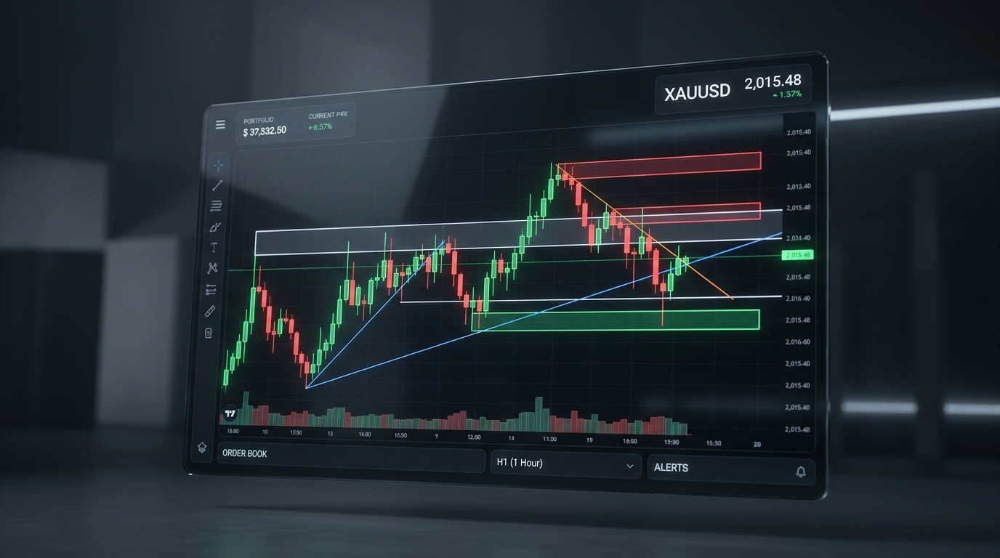
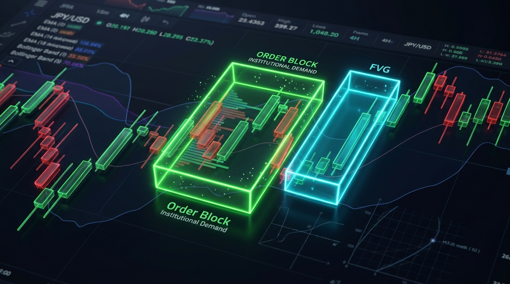

## Hướng dẫn chuyên sâu về Chiến Lược Bắt Vùng Thanh Khoản Vàng XAUUSD

Thị trường Vàng (XAUUSD) không vận hành theo ngẫu nhiên, nó vận hành theo dòng chảy của thanh khoản. Nếu bạn vẫn đang giao dịch dựa trên các chỉ báo lạc hậu như RSI, MACD hay các đường MA cắt nhau, bạn không phải là nhà giao dịch, bạn là "thanh khoản" cho cá mập. Tại sao tài khoản của bạn liên tục cháy dù đã phân tích kỹ thuật rất bài bản? Câu trả lời nằm ở việc bạn chưa hiểu cách các tổ chức tài chính (Smart Money) thao túng cấu trúc thị trường để quét Stop Loss của đám đông.

*Hình 1: Mô hình quét thanh khoản (Liquidity Sweep) và bẫy giá Smart Money trên khung biểu đồ Vàng XAUUSD*

Chào mừng bạn đến với tư duy giao dịch chuyên nghiệp. Bài viết này sẽ vạch trần cách vận hành của "nhà cái" và cung cấp cho bạn khung chiến lược **Chiến Lược Bắt Vùng Thanh Khoản Vàng XAUUSD** để tối ưu hóa lợi nhuận với tỷ lệ R:R tối thiểu 1:2.5.

---

## Bản chất của sự thất bại: Tại sao bạn bị cá mập "ăn thịt"?

Đa số nhà giao dịch cá nhân (Retail Traders) thất bại không phải vì thiếu kiến thức, mà vì họ đang giao dịch với "góc nhìn ngược". 

1. **Bẫy thanh khoản (Liquidity Traps):** Những vùng hỗ trợ/kháng cự rõ ràng trên khung D1 hay H4 thường là nơi cá mập đặt lệnh chờ lớn để khớp thanh khoản. Khi giá chạm vào đó, thay vì đảo chiều như sách giáo khoa, nó sẽ quét qua để kích hoạt lệnh Stop Loss của bạn, sau đó mới di chuyển theo hướng dự đoán.
2. **Thiếu tư duy SMC:** Bạn không nhìn thấy sự dịch chuyển của **Order Block (OB)** hay các **Fair Value Gap (FVG)**. Bạn đang vào lệnh ở giữa vùng "nhiễu" thay vì đợi giá hồi về vùng giá trị (Premium/Discount).
3. **Chi phí tâm lý:** Việc gồng lỗ quá lâu và chốt lời quá sớm khiến tỷ lệ R:R của bạn luôn âm, dẫn đến việc dù thắng 50% số lệnh vẫn cháy tài khoản.

---

## Chiến Lược Bắt Vùng Thanh Khoản Vàng XAUUSD: Quy trình 4 bước

Để thành công, bạn cần kỷ luật thực thi theo quy trình "Smart Money" sau đây:

*Hình 2: Sơ đồ cấu trúc thị trường SMC - Nhận diện Bullish BOS (Break of Structure) & CHoCH (Change of Character)*

### Bước 1: Xác định cấu trúc thị trường (Market Structure)
Luôn bắt đầu từ khung H4 hoặc H1 để xác định xu hướng chính. Tìm kiếm các điểm **BOS (Break of Structure)** để xác nhận xu hướng tiếp diễn. Nếu giá phá vỡ đỉnh cũ, đó là xu hướng tăng. Nếu giá phá vỡ đáy cũ, đó là xu hướng giảm. Đừng bao giờ đi ngược xu hướng nếu chưa có tín hiệu **CHoCH (Change of Character)** rõ ràng.

### Bước 2: Nhận diện vùng thanh khoản (Liquidity Sweeps)
Cá mập cần thanh khoản để khớp lệnh lớn. Họ sẽ tạo ra các mô hình 2 đỉnh, 2 đáy hoặc các vùng tích lũy (Consolidation) để dụ bạn vào lệnh. 
*   **Chiến thuật:** Hãy đợi giá "quét" qua các vùng này (Sweep). Đó chính là lúc "Smart Money" đã vào lệnh. Đây là điểm vào lệnh lý tưởng nhất.

### Bước 3: Tìm điểm vào lệnh tại Order Block (OB) và FVG
Sau khi quét thanh khoản, giá thường để lại các khoảng trống **Fair Value Gap (FVG)**. Đây là sự mất cân bằng giữa cung và cầu. Giá có xu hướng quay lại lấp đầy khoảng trống này trước khi tiếp tục xu hướng chính.
*   **Entry:** Đặt lệnh tại vùng **Order Block** nằm ngay phía dưới (nếu buy) hoặc trên (nếu sell) của FVG.

*Hình 3: Vùng cầu Order Block (OB) kết hợp khoảng trống mất cân bằng Fair Value Gap (FVG)*

### Bước 4: Thiết lập tỷ lệ R:R tối thiểu 1:2.5
Đây là chìa khóa để tồn tại. Nếu bạn chấp nhận rủi ro 1 phần để đổi lấy 2.5 phần lợi nhuận, bạn chỉ cần tỷ lệ thắng 40% là đã có lợi nhuận bền vững.

---

## Bảng thông số thực chiến (Ví dụ cho lệnh Mua Vàng)

| Thông số | Vùng giá thiết lập | Lưu ý kỹ thuật |
| :--- | :--- | :--- |
| **Entry** | Vùng OB sau khi Sweep | Đợi nến rút chân tại vùng OB |
| **Stop Loss** | Dưới đáy vừa quét thanh khoản | Đặt cách râu nến 50-100 pips |
| **Take Profit 1** | Đỉnh gần nhất (Liquidity cũ) | Chốt 50% khối lượng |
| **Take Profit 2** | Vùng FVG đối diện | Tối ưu hóa R:R lên 1:3 hoặc hơn |

> 💡 **Lưu ý thực chiến:** Luôn kiểm tra tin tức trên lịch kinh tế trước khi vào lệnh. Vàng cực kỳ nhạy cảm với tin tức lãi suất và chỉ số USD (DXY). Nếu có tin mạnh, hãy đứng ngoài thị trường để tránh những cú quét thanh khoản ảo.

---

## Tối ưu hóa hiệu suất bằng công nghệ

Trong kỷ nguyên số, việc phân tích thủ công 24/7 là không khả thi. Các nhà giao dịch chuyên nghiệp đang chuyển dịch sang sử dụng Bot EA (Expert Advisor) để loại bỏ yếu tố cảm xúc và tối ưu hóa hạ tầng giao dịch. Một hệ thống EA chuẩn SMC giúp bạn:
1. **Tự động hóa:** Vào lệnh đúng vùng thanh khoản mà không cần canh bảng điện.
2. **Kiểm soát rủi ro:** SL/TP được thiết lập cứng ngay khi lệnh được khớp.
3. **Chi phí tối ưu:** Giảm thiểu chi phí cơ hội và tránh được những cú "trượt giá" do thao tác chậm.

*Hình 4: Hệ thống Bot EA MT5 tự động hóa khớp lệnh độ trễ dưới 10ms trên nền tảng máy chủ VPS*

---

## ⚡ Theo Dõi Tín Hiệu Giao Dịch & Nhận Định SMC Real-time

Đừng để những cú quét râu nến bất ngờ lấy đi nguồn vốn của bạn:

- 📊 **Khung Tín Hiệu Sống Real-time:** Truy cập [Trading Signal VIP (https://tintucnft.com)](https://tintucnft.com/trading-signal-vip) để theo dõi các vị thế Vàng & Crypto cập nhật từng phút.
- 🤖 **Kiểm Chứng Hiệu Suất Bot EA Myfxbook:** Truy cập ngay  [Bot EA MT5 (https://tintucnft.com)](https://tintucnft.com/bot-ea-trading) để xem track record thực tế với Max Drawdown dưới 10%.
- ✈️ **Cập Nhật Tín Hiệu & Chiến Lược Mỗi Ngày:** Tham gia ngay [Kênh Telegram MCG Community](https://t.me/channelmcg) để không bỏ lỡ các cảnh báo thị trường khẩn cấp.
- 💬 **Điều Kiện Tham Gia Nhóm Tín Hiệu:** [Liên Hệ Admin Hỗ Trợ (@willrich)](https://t.me/willrich) để được tư vấn kích hoạt tài khoản đối tác chuẩn quốc tế.
