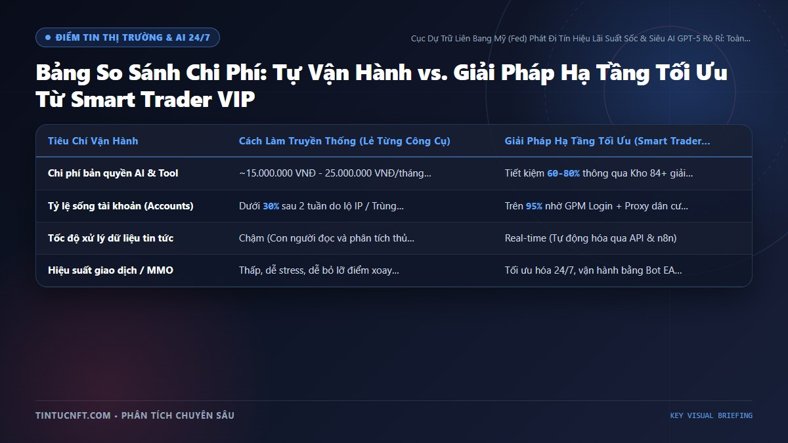

## Tín Hiệu Sốc Từ Fed Và Cơn Sốc Hạ Tầng AI: Khi "Cá Voi" Định Hình Lại Cuộc Chơi

*Đồng Bitcoin được kết nối với cáp quang dữ liệu, minh họa cho làn sóng công nghệ và tài chính toàn cầu.*

Thị trường tài chính toàn cầu đang đứng trước một ngã ba đường lịch sử. Những tuyên bố mới nhất từ Cục Dự Trữ Liên Bang Mỹ (Fed) về lộ trình lãi suất đang tạo ra những đợt sóng ngầm cực lớn, trong khi sự bùng nổ của các mô hình **siêu AI GPT-5** và công nghệ sinh tạo đa phương tiện (ElevenLabs, Suno, Runway) đang tái định hình hoàn toàn cách dòng tiền thông minh di chuyển. 

Tuy nhiên, nghịch lý lớn nhất mà tôi – một kiến trúc sư hạ tầng AI và tự động hóa – quan sát được từ hàng nghìn nhà đầu tư (Trader) và dân làm MMO (Make Money Online) chính là: **Họ chết vì thiếu hạ tầng trước khi kịp nhận ra xu hướng vĩ mô.**

Trong khi các quỹ lớn dùng hệ thống giao dịch định lượng bằng AI để quét dữ liệu Fed trong mili-giây, thì các trader cá nhân lại đang cháy tài khoản vì dùng bot giao dịch trên VPS trôi nổi. Trong khi các agency marketing kiếm hàng nghìn đô la từ việc nuôi hàng trăm tài khoản TikTok/YouTube bằng **Antidetect Browser (GPM Login)** và **proxy dân cư sạch**, thì anh em MMO nghiệp dư lại liên tục bị khóa tài khoản (checkpoint) chỉ vì tiếc vài chục nghìn mua nguyên liệu chuẩn.

 Bài viết này sẽ bóc tách tường tận mối quan hệ nhân quả giữa **tác động lãi suất fed đến ai và crypto**, đồng thời cung cấp giải pháp hạ tầng tự động hóa chuẩn "Smart Trader VIP" giúp bạn tối ưu 80% chi phí vận hành.

---

## Bản Chất Sự Thật: Vì Sao 90% Trader Và Dân MMO Thất Bại Trong Mùa Biến Động?

### 1. Góc nhìn vĩ mô: Lãi suất Fed và dòng tiền định lượng
Khi Fed phát đi tín hiệu "diều hâu" hoặc bất ngờ đảo chiều chính sách, thanh khoản toàn cầu lập tức co cụm hoặc tràn ra. **Tác động lãi suất fed đến ai và crypto** không nằm ở lý thuyết sách giáo khoa, mà nằm ở tốc độ phản ứng của thuật toán. 

Các quỹ đầu tư không đọc báo bằng mắt người; họ sử dụng API kết nối trực tiếp với các mô hình LLM cao cấp để phân tích từng từ trong biên bản họp FOMC, sau đó tự động khớp lệnh trên thị trường phái sinh. Nếu bạn giao dịch thủ công hoặc dùng các công cụ phân tích lỗi thời, bạn chính là thanh khoản cho cá mập.

### 2. Góc nhìn hạ tầng: Điểm mù checkpoint và chi phí bản quyền
Trong khi đó, ở mảng MMO và tài sản số, "nỗi đau" lớn nhất không phải là thiếu chiến lược, mà là **bài toán chi phí và độ bền của hạ tầng**. 
* Nuôi 100 tài khoản xã hội để seeding crypto nhưng dùng VPS datacenter giá rẻ $\rightarrow$ Lập tức bị quét IP.
* Dùng tool AI tạo content (ChatGPT, Claude, Midjourney) qua tài khoản share chung, quá tải token giữa giờ giao dịch $\rightarrow$ Mất cơ hội chốt lời.
* Không tối ưu hóa quy trình tự động hóa bằng **n8n** hoặc Python script $\rightarrow$ Tốn 80% thời gian cho những việc chân tay thay vì tập trung vào chiến lược vốn.

> 💡 **Lưu ý thực chiến:** Đừng bao giờ tiếc tiền đầu tư vào hạ tầng gốc. Một con VPS tối ưu độ trễ (latency) kết hợp Proxy dân cư sạch và trình duyệt chống phát hiện (Antidetect) chính là "giáp chống đạn" duy nhất giúp bạn sống sót trước các thuật toán quét tài khoản gắt gao hiện nay.

---

## Giải Pháp Toàn Diện: Xây Dựng Hạ Tầng AI & Tự Động Hóa Đạt Chuẩn Institutional

Để giải quyết triệt để bài toán chi phí tài khoản bản quyền và bảo vệ hệ thống tài khoản khỏi các đợt quét của nền tảng, bạn cần áp dụng mô hình hạ tầng khép kín sau:

### Bước 1: Thiết Lập Vùng An Toàn Cho Chuỗi Tài Khoản (Anti-Detection Stack)
Tuyệt đối không dùng chung một máy tính hoặc một trình duyệt cho nhiều tài khoản tài chính/MMO. 
* Sử dụng **GPM Login** để cô lập từng môi trường trình duyệt với thông số phần cứng (fingerprint) riêng biệt.
* Kết hợp dòng **Proxy dân cư xoay sạch** để qua mặt mọi hệ thống AI phòng chống gian lận của các sàn giao dịch hoặc nền tảng mạng xã hội.

### Bước 2: Tự Động Hóa Workflow Đỉnh Cao Với AI & n8n
Thay vì tốn chi phí thuê nhân sự hàng tháng cho các tác vụ lặp đi lặp lại, hãy tích hợp API của các siêu AI (ChatGPT, Claude, ElevenLabs, Runway) thông qua nền tảng tự động hóa **n8n** hoặc Python:
* **Tự động bắt tin tức Fed/Crypto:** Bot quét dữ liệu vĩ mô $\rightarrow$ Phân tích bằng Claude API $\rightarrow$ Đẩy tín hiệu trực tiếp vào Telegram Channel của bạn trong vòng chưa đầy 5 giây.
* **Sản xuất nội dung đa nền tảng:** Tự động hóa quy trình từ tạo kịch bản, sinh giọng đọc (ElevenLabs), dựng video (CapCut/Runway) để phủ sóng thương hiệu dự án crypto.

---

## Bảng So Sánh Chi Phí: Tự Vận Hành vs. Giải Pháp Hạ Tầng Tối Ưu Từ Smart Trader VIP

*Tổng hợp trực quan: Bảng So Sánh Chi Phí: Tự Vận Hành vs. Giải Pháp Hạ Tầng Tối Ưu Từ Smart Trader VIP*

| Tiêu Chí Vận Hành | Cách Làm Truyền Thống (Lẻ Từng Công Cụ) | Giải Pháp Hạ Tầng Tối Ưu (Smart Trader VIP) |
| :--- | :--- | :--- |
| **Chi phí bản quyền AI & Tool** | ~15.000.000 VNĐ - 25.000.000 VNĐ/tháng (Mua lẻ giá gốc) | **Tiết kiệm 60-80%** thông qua Kho 84+ giải pháp MMO |
| **Tỷ lệ sống tài khoản (Accounts)** | Dưới 30% sau 2 tuần do lộ IP / Trùng Hardware Fingerprint | **Trên 95%** nhờ GPM Login + Proxy dân cư sạch + VPS chuyên dụng |
| **Tốc độ xử lý dữ liệu tin tức** | Chậm (Con người đọc và phân tích thủ công) | **Real-time (Tự động hóa qua API & n8n)** |
| **Hiệu suất giao dịch / MMO** | Thấp, dễ stress, dễ bỏ lỡ điểm xoay chiều dòng tiền | **Tối ưu hóa 24/7**, vận hành bằng Bot EA và Automation |

---

## Kết Luận: Đón Đầu Điểm Xoay Chiều Của Dòng Tiền Thông Minh

Thị trường tài chính và công nghệ không có chỗ cho sự chậm trễ. Khi Fed thay đổi chính sách và các thế hệ AI mới ra đời, đó là lúc rủi ro cao nhất đi kèm với cơ hội đổi đời lớn nhất. Việc bạn cần làm ngay lúc này không phải là đoán già đoán non đường đi của giá, mà là **trang bị cho mình một hạ tầng công nghệ và tài nguyên bản quyền vững chắc nhất** để chớp lấy từng mili-giây của thị trường.

---

## 🌐 Kho Tài Nguyên Bản Quyền AI & Hạ Tầng MMO Tự Động Hóa

Hạ tầng sạch và công cụ bản quyền ổn định chính là nền tảng quyết định thành bại của mọi dự án MMO & Automation:

- 🛒 **Kho Tổng 84+ Công Cụ AI & Bản Quyền MMO Giá Sỉ:** Khám phá trọn bộ 6 danh mục công cụ (Siêu AI, Coding Cloud, Creative Video/Voice, VPN Sạch & Tài Khoản Số) tại [Kho AI & Hạ Tầng MMO (tintucnft.com)](https://tintucnft.com/kho-ai-ha-tang-mmo).
- ⚡ **Mua Hàng Tự Động 24/7:** Giao dịch nhận tài khoản/key bản quyền siêu tốc trong 30 giây qua bot Telegram: [Bot Mua Tự Động (@chatgpsplusbot)](https://t.me/chatgpsplusbot).
- 🤖 **Kiểm Chứng Hiệu Suất Bot EA Myfxbook:** Truy cập ngay  [Bot EA MT5 (https://tintucnft.com)](https://tintucnft.com/bot-ea-trading) để xem track record thực tế với Max Drawdown dưới 10%.
- 🎁 **Quà Tặng Độc Quyền (Lead Magnet):** Nhận **License GPM Login chính hãng (Tặng Key Free)** kèm bộ **Data 50+ AI Prompts & Workflows** tự động hóa: [Nhắn Tin Admin (@willrich)](https://t.me/willrich).
- ✈️ **Cập Nhật Tín Hiệu & Chiến Lược Mỗi Ngày:** Tham gia ngay [Kênh Telegram MCG Community](https://t.me/channelmcg) để không bỏ lỡ các cảnh báo thị trường khẩn cấp.