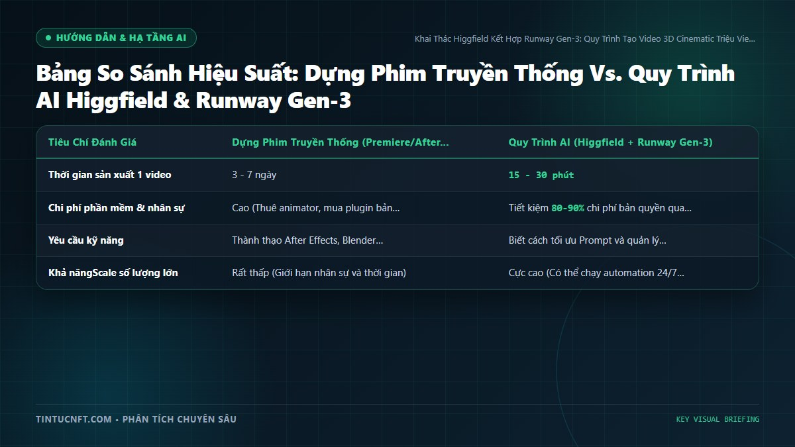

## Khai Thác Higgfield Kết Hợp Runway Gen-3: Quy Trình Tạo Video 3D Cinematic Triệu View Không Cần Biết Dựng Phim

*Quy trình tạo video AI và tài sản số hiện đại giúp tối ưu hóa thời gian và nâng cao chất lượng nội dung.*

*Bí kíp kết hợp bộ đôi công cụ AI sáng tạo hình ảnh và chuyển động đỉnh cao giúp dân làm content tối ưu 90% thời gian dựng phim.*

Bạn đang mất hàng tuần mài giũa từng khung hình trên Premiere hay After Effects nhưng video làm ra vẫn nhàm chán, không bắt kịp xu hướng thị giác? Trong khi đó, các kênh TikTok, Reels, YouTube Shorts làm nội dung tài chính, crypto hay sản phẩm MMO lại liên tục tung ra những thước phim 3D cinematic triệu view chỉ bằng vài dòng lệnh. Sự thật là cuộc chơi dựng phim truyền thống đã lỗi thời. Nếu bạn không biết **khai thác higgfield kết hợp runway gen 3**, bạn đang tự bỏ lại mình phía sau trong cuộc đua tốc độ của kỷ nguyên AI Video.

---

## Bản Chất Vấn Đề: Tại Sao Dân MMO & Content Creator Lại Kiệt Quệ Vì Video 3D?

Trong thế giới MMO và sáng tạo nội dung hiện đại, video là "vũ khí tối thượng" để chuyển đổi traffic. Tuy nhiên, để sản xuất ra một video 3D phong cách cinematic chất lượng cao, các đội ngũ sản xuất thường vướng phải ba tử huyệt chí mạng:

1. **Chi phí dựng hình (3D Modeling) quá đắt đỏ:** Thuê nhân sự Blender, Cinema 4D tốn kém, thời gian hoàn thiện một project kéo dài từ 5 - 7 ngày.
2. **Hiệu suất render "bóp nghẹt" phần cứng:** Chạy render 3D trên máy tính cá nhân hoặc VPS yếu dẫn đến sập nguồn, giật lag, tiêu tốn điện năng và thời gian chờ đợi vô ích.
3. **Thiếu tính linh hoạt:** Khi thuật toán nền tảng thay đổi liên tục, nội dung cần đổi mới theo giờ. Dựng phim kiểu cũ không kịp đáp ứng "tốc độ ánh sáng" của xu hướng thị trường.

Để giải bài toán này, dân kỹ thuật hệ thống và các "cá mập" MMO không tốn thời gian học dựng phim chuyên nghiệp. Họ xây dựng quy trình tự động hóa bằng cách **khai thác higgfield kết hợp runway gen 3** – bộ đôi siêu AI tạo hình ảnh 3D chiều sâu và chuyển động điện ảnh mượt mà bậc nhất hiện nay.

---

## Giải Pháp & Quy Trình Kỹ Thuật: Khai Thác Higgfield Kết Hợp Runway Gen-3 Từ A-Z

Để tối ưu hóa hiệu suất và chi phí tài nguyên, quy trình sản xuất video 3D cinematic không qua khâu dựng hình truyền thống được thực hiện qua các bước thực chiến sau đây:

### Bước 1: Khởi Tạo Ý Tưởng & Sinh Ảnh Nền Tảng (Base Image) Trên Higgfield AI

Higgfield là công cụ tối tân trong việc tạo dựng nhân vật và không gian 3D có chiều sâu, cực kỳ phù hợp cho các concept vũ trụ, crypto, cyberpunk hoặc chân dung cinematic.

* **Truy cập hạ tầng:** Sử dụng tài khoản bản quyền sạch thông qua Antidetect Browser (như GPM Login) kết hợp Proxy dân cư sạch để bảo vệ session, tránh tình trạng checkpoint vô cớ từ hệ thống AI.
* **Tạo Prompt:** Viết câu lệnh mô tả chi tiết bằng tiếng Anh (hoặc tối ưu hóa qua ChatGPT Plus). Ví dụ: *"A cyberpunk trader looking at holographic charts in a futuristic skyscraper, 3d render, cinematic lighting, unreal engine 5, 8k resolution"*
* **Xuất file:** Lấy bức hình 3D có bố cục hoàn hảo nhất làm đầu vào (Image-to-Video) cho bước tiếp theo.

### Bước 2: Thổi Hồn Chuyển Động Điện Ảnh Bằng Runway Gen-3 Alpha

Sau khi đã có bức ảnh nền tảng chất lượng từ Higgfield, chúng ta chuyển sang giai đoạn tạo chuyển động vật lý. **Runway Gen-3** là tiêu chuẩn vàng hiện tại về độ mượt mà, hiểu biết ngữ cảnh vật lý và khả năng kiểm soát camera.

* **Import Image:** Tải ảnh từ Higgfield lên nền tảng Runway.
* **Thiết lập Camera Control:** Tùy chỉnh góc máy (Pan, Zoom, Roll) để tạo hiệu ứng cinematic chuyên nghiệp. 
* **Motion Brush / Prompt Motion:** Khoanh vùng các chi tiết cần chuyển động (như dòng tiền chạy qua màn hình, hơi thở nhân vật, ánh sáng neon nhấp nháy) và nhập prompt chuyển động.
* **Render & Download:** Hệ thống đám mây của Runway sẽ xử lý và trả về video chất lượng cao chỉ sau vài phút.

### Bước 3: Hoàn Thiện Hậu Kỳ Tự Động Với Workflow Tích Hợp

Với hàng trăm tài khoản cần nuôi để sản xuất video hàng loạt cho chiến dịch MMO, việc thao tác thủ công là bất khả thi. Các kỹ sư hạ tầng thường kết hợp API của các công cụ này vào hệ thống tự động hóa n8n hoặc Python scripts:

* Tự động lấy prompt từ Google Sheets.
* Gửi request tạo ảnh đến Higgfield, sau đó đẩy sang Runway Gen-3.
* Tự động tải video về VPS, chèn nhạc bản quyền từ kho AI và đẩy thẳng lên các nền tảng mạng xã hội.

> 💡 **Lưu ý thực chiến:** Khi nuôi hàng loạt tài khoản AI sáng tạo (Runway, Higgfield, Midjourney), tuyệt đối không dùng chung một địa chỉ IP hoặc trình duyệt thông thường. Hãy sử dụng Antidetect Browser GPM Login kết hợp Proxy dân cư sạch để tài khoản luôn ở trạng thái trust cao nhất, tránh tình trạng quét IP gây mất sạch credit đã nạp.

---

## Bảng So Sánh Hiệu Suất: Dựng Phim Truyền Thống Vs. Quy Trình AI Higgfield & Runway Gen-3

*Tổng hợp trực quan: Bảng So Sánh Hiệu Suất: Dựng Phim Truyền Thống Vs. Quy Trình AI Higgfield & Runway Gen-3*

| Tiêu Chí Đánh Giá | Dựng Phim Truyền Thống (Premiere/After Effects) | Quy Trình AI (Higgfield + Runway Gen-3) |
| :--- | :--- | :--- |
| **Thời gian sản xuất 1 video** | 3 - 7 ngày | 15 - 30 phút |
| **Chi phí phần mềm & nhân sự** | Cao (Thuê animator, mua plugin bản quyền đắt đỏ) | Tiết kiệm 80-90% chi phí bản quyền qua kho sỉ |
| **Yêu cầu kỹ năng** | Thành thạo After Effects, Blender, Premiere | Biết cách tối ưu Prompt và quản lý workflow |
| **Khả năngScale số lượng lớn** | Rất thấp (Giới hạn nhân sự và thời gian) | Cực cao (Có thể chạy automation 24/7 qua API) |
| **Độ bắt trend thị giác** | Chậm (Mất thời gian dựng hình từ đầu) | Tức thì (Cập nhật xu hướng trong vài phút) |

---

## Tối Ưu Chi Phí Bản Quyền Tài Khoản AI & Hạ Tầng MMO

Sở hữu công cụ mạnh là chưa đủ, bài toán kinh tế (ROI) mới là thứ quyết định bạn có sống sót được trong ngành MMO hay không. Việc mua lẻ từng tài khoản Runway Gen-3 hay Higgfield với giá gốc sẽ nhanh chóng làm bào mòn lợi nhuận của bạn. 

Giải pháp tối ưu nhất được các "cao thủ" hạ tầng áp dụng là sử dụng **Kho tài nguyên 84+ công cụ bản quyền giá sỉ**. Thay vì bỏ ra hàng nghìn đô la cho các góiEnterprise, bạn có thể tiếp cận toàn bộ hệ sinh thái Siêu AI, Coding Cloud, Creative Video/Voice (bao gồm tài khoản Runway, Higgfield, ElevenLabs, Midjourney...) với chi phí tối ưu nhất, tiết kiệm từ 60-80%.

---

## 🌐 Kho Tài Nguyên Bản Quyền AI & Hạ Tầng MMO Tự Động Hóa

Hạ tầng sạch và công cụ bản quyền ổn định chính là nền tảng quyết định thành bại của mọi dự án MMO & Automation:

- 🛒 **Kho Tổng 84+ Công Cụ AI & Bản Quyền MMO Giá Sỉ:** Khám phá trọn bộ 6 danh mục công cụ (Siêu AI, Coding Cloud, Creative Video/Voice, VPN Sạch & Tài Khoản Số) tại [Kho AI & Hạ Tầng MMO](https://tintucnft.com/kho-ai-ha-tang-mmo).
- ⚡ **Mua Hàng Tự Động 24/7:** Giao dịch nhận tài khoản/key bản quyền siêu tốc trong 30 giây qua bot Telegram: [Bot Mua Tự Động (@chatgpsplusbot)](https://t.me/chatgpsplusbot).
- 🤖 **Kiểm Chứng Hiệu Suất Bot EA Myfxbook:** Truy cập ngay  [Bot EA MT5 (https://tintucnft.com)](https://tintucnft.com/bot-ea-trading) để xem track record thực tế với Max Drawdown dưới 10%.
- 🎁 **Quà Tặng Độc Quyền (Lead Magnet):** Nhận **License GPM Login chính hãng (Tặng Key Free)** kèm bộ **Data 50+ AI Prompts & Workflows** tự động hóa: [Nhắn Tin Admin (@willrich)](https://t.me/willrich).
- ✈️ **Cập Nhật Tín Hiệu & Chiến Lược Mỗi Ngày:** Tham gia ngay [Kênh Telegram MCG Community](https://t.me/channelmcg) để không bỏ lỡ các cảnh báo thị trường khẩn cấp.