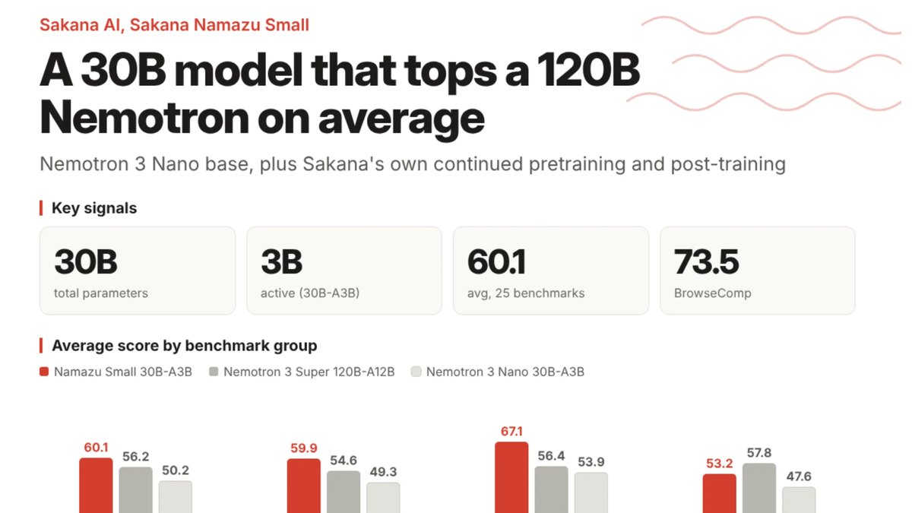
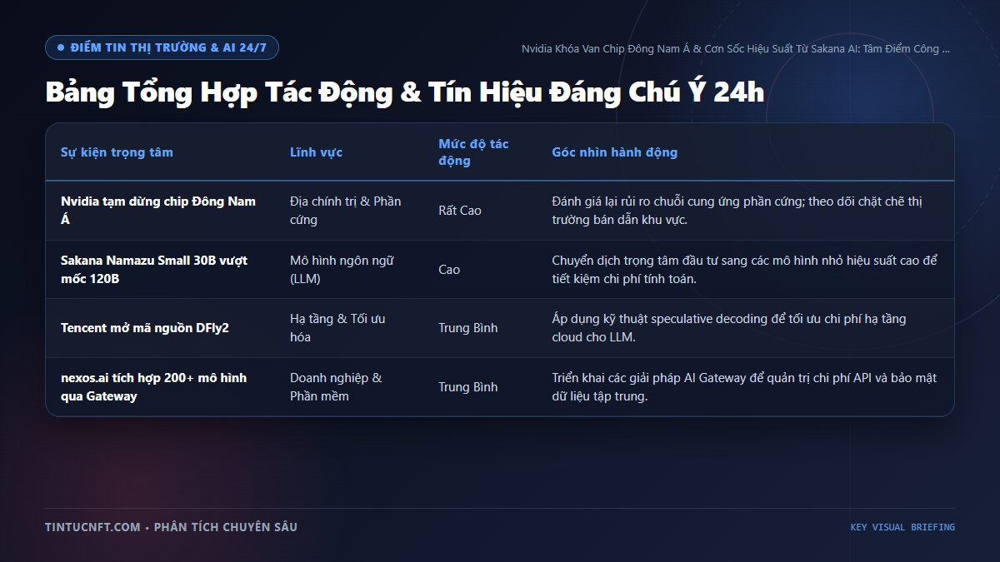

Thị trường tài chính và công nghệ toàn cầu hôm nay đang chứng kiến những bước ngoặt mang tính địa chính trị lẫn đột phá kỹ thuật sâu sắc. Trong bối cảnh Washington tiếp tục siết chặt các vòng kim cô kiểm soát công nghệ đối với Bắc Kinh, các chuỗi cung ứng phần cứng tại châu Á buộc phải tái định vị. Song song đó, tốc độ tối ưu hóa hạ tầng mô hình ngôn ngữ lớn (LLM) và các nền tảng AI Gateway đang tăng tốc với tốc độ chóng mặt, định hình lại trật tự cạnh tranh toàn cầu từ Thung lũng Silicon đến châu Á.

## Đột Phá AI & Hạ Tầng Mô Hình Mới

*Biểu đồ hiệu suất so sánh các thông số kỹ thuật của mô hình Sakana Namazu Small với các đối thủ trên thị trường. (Nguồn: MarkTechPost)*

- **Sakana AI Releases Namazu Small, a 30B Model Built on Nemotron 3 Nano**: Sakana AI vừa chính thức phát hành **Sakana Namazu Small**, một mô hình lập luận quy mô **30B-A3B** được xây dựng trên nền tảng **NVIDIA Nemotron 3 Nano**. Đáng kinh ngạc, mô hình này đạt điểm trung bình **60.1 trên 25 benchmark** tiêu chuẩn, vượt qua cả người đàn anh **120B Nemotron 3 Super** vốn chỉ dừng lại ở mức **56.2**. Thành tựu này chứng minh rằng các mô hình quy mô vừa (small language models) hoàn toàn có khả năng đạt hiệu suất vượt trội nhờ kiến trúc thông minh và chiến lược huấn luyện tối ưu, mở ra kỷ nguyên tiết kiệm chi phí vận hành đáng kể cho các doanh nghiệp ứng dụng AI. [Sakana AI Releases Namazu Small](https://www.marktechpost.com/2026/11/26/sakana-ai-namazu-small-30b-nemotron-3-nano/)

- **Tencent Open-Sources DFly2: Speculative Decoding That Reuses the Target’s Sparse KV Cache**: **Tencent** đã mã nguồn mở **DFly2**, một giải pháp giải mã phỏng đoán (speculative decoding drafter) dành riêng cho các LLM có cơ chế thưa thớt (sparse-attention). Bằng cách cho phép mỗi lớp nháp tái sử dụng bộ nhớ **KV cache** và bộ chọn **top-k indexer** của mô hình mục tiêu, DFly2 không tốn thêm bộ nhớ KV nháp và đẩy thông lượng phục vụ ngữ cảnh dài **64K** lên mức ấn tượng. Đây là một mảnh ghép hạ tầng cực kỳ quan trọng giúp các nhà cung cấp dịch vụ đám mây cắt giảm mạnh chi phí phần cứng khi phục vụ lượng lớn người dùng đồng thời. [Tencent Open-Sources DFly2](https://www.marktechpost.com/2026/11/26/tencent-dfly2-speculative-decoding-sparse-models/)

- **nexos.ai AI Adoption Platform puts 200+ models behind one AI Gateway**: Nền tảng **nexos.ai** vừa ra mắt giải pháp tích hợp hơn **200+ mô hình AI** đằng sau một cổng **AI Gateway** duy nhất, đi kèm hệ thống giới hạn ngân sách và quản trị (governance) được tích hợp sẵn. Giải pháp này giải quyết triệt để bài toán đau đầu của các CIO doanh nghiệp trong việc quản lý chi phí API, kiểm soát rủi ro bảo mật và chuyển đổi linh hoạt giữa các nhà cung cấp mô hình mà không cần viết lại mã nguồn. [nexos.ai AI Adoption Platform](https://www.marktechpost.com/2026/11/26/nexos-ai-ai-gateway-200-models-governance/)

## Chuyển Động Thị Trường, Pháp Lý & Vĩ Mô

- **Nvidia hits pause on chip shipments to Southeast Asia**: **Nvidia** đã chính thức yêu cầu các đối tác sản xuất tạm dừng việc vận chuyển các lô hàng máy chủ chứa chip AI cao cấp đến **Malaysia, Singapore, Thái Lan và Indonesia**. Động thái này diễn ra khi chính quyền **Hoa Kỳ** siết chặt hơn nữa các biện pháp kiểm soát xuất khẩu nhằm bịt kín mọi kẽ hở có thể khiến chip AI tiên tiến lọt vào tay Trung Quốc qua các bên thứ ba. Quyết định này không chỉ tạo ra cú sốc ngắn hạn cho các trung tâm dữ liệu tại Đông Nam Á mà còn buộc các nhà đầu tư phải đánh giá lại biên lợi nhuận và rủi ro chuỗi cung ứng của Nvidia trong khu vực. [TechCrunch AI](https://techcrunch.com/2026/11/26/nvidia-hits-pause-on-chip-shipments-to-southeast-asia/)

## Bảng Tổng Hợp Tác Động & Tín Hiệu Đáng Chú Ý 24h

*Tổng hợp trực quan: Bảng Tổng Hợp Tác Động & Tín Hiệu Đáng Chú Ý 24h*

| Sự kiện trọng tâm | Lĩnh vực | Mức độ tác động | Góc nhìn hành động |
| :--- | :--- | :--- | :--- |
| **Nvidia tạm dừng chip Đông Nam Á** | Địa chính trị & Phần cứng | **Rất Cao** | Đánh giá lại rủi ro chuỗi cung ứng phần cứng; theo dõi chặt chẽ thị trường bán dẫn khu vực. |
| **Sakana Namazu Small 30B vượt mốc 120B** | Mô hình ngôn ngữ (LLM) | **Cao** | Chuyển dịch trọng tâm đầu tư sang các mô hình nhỏ hiệu suất cao để tiết kiệm chi phí tính toán. |
| **Tencent mở mã nguồn DFly2** | Hạ tầng & Tối ưu hóa | **Trung Bình** | Áp dụng kỹ thuật speculative decoding để tối ưu chi phí hạ tầng cloud cho LLM. |
| **nexos.ai tích hợp 200+ mô hình qua Gateway** | Doanh nghiệp & Phần mềm | **Trung Bình** | Triển khai các giải pháp AI Gateway để quản trị chi phí API và bảo mật dữ liệu tập trung. |

## Đọc Nhanh 60 Giây
- **Nvidia** đóng băng tạm thời các lô hàng máy chủ chứa chip AI hướng đến Malaysia, Singapore, Thái Lan và Indonesia nhằm tuân thủ quy định ngặt nghèo mới của Mỹ.
- **Sakana AI** gây bất ngờ lớn khi mô hình 30B Namazu Small đánh bại cả phiên bản 120B Nemotron 3 Super trên các bài kiểm tra benchmark tiêu chuẩn.
- **Tencent** tối ưu hóa hiệu suất ngữ cảnh 64K thông qua mã nguồn mở DFly2, giải quyết bài toán tiêu thụ bộ nhớ KV cache trong LLM.
- **nexos.ai** ra mắt nền tảng quản trị duy nhất cho phép doanh nghiệp truy cập hơn 200+ mô hình AI kèm kiểm soát ngân sách thời gian thực.

---
## 🎯 Cổng Thông Tin & Công Cụ Giao Dịch Độc Quyền
- ⚡ **Khung Tín Hiệu Sống Real-time:** [Trading Signal VIP](https://tintucnft.com/trading-signal-vip)
- 🤖 **Kiểm Chứng Hiệu Suất Bot EA Myfxbook:** Truy cập ngay  [Bot EA MT5 (https://tintucnft.com)](https://tintucnft.com/bot-ea-trading) để xem track record thực tế với Max Drawdown dưới 10%.
- 🌐 **Hạ Tầng Tự Động Hóa:** [Kho AI & Hạ Tầng MMO](https://tintucnft.com/kho-ai-ha-tang-mmo)
- ✈️ **Nhận Bản Tin Hàng Ngày:** Tham gia ngay [Kênh Telegram MCG Community](https://t.me/channelmcg).