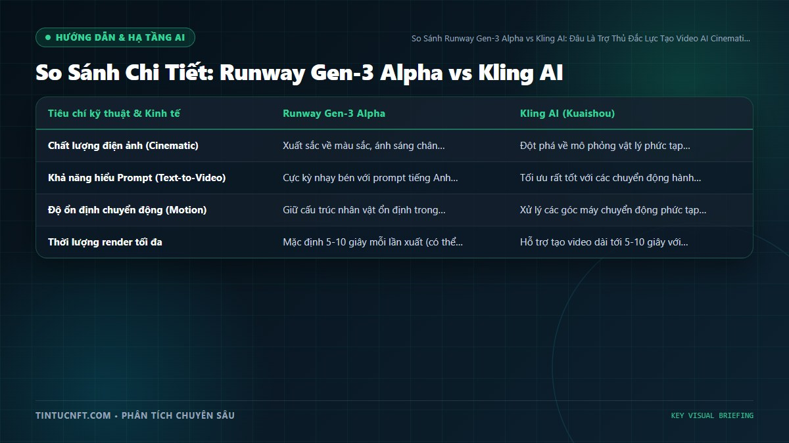

## So Sánh Runway Gen-3 Alpha vs Kling AI: Đâu Là Trợ Thủ Đắc Lực Tạo Video AI Cinematic Cho Dân MMO?

*Điện thoại thông minh hiển thị giao diện tạo video AI đặt cạnh đống tiền xu, tượng trưng cho cơ hội kiếm tiền từ nội dung số.*

*Phân tích chi tiết chất lượng chuyển động, độ phân giải và chi phí render giữa hai siêu phẩm tạo video AI hàng đầu hiện nay.*

---

Thị trường video ngắn, TikTok/Reels và các chiến dịch Affiliate Marketing đang bước vào giai đoạn khốc liệt. Khán giả đã bội thực với những video nhạt nhẽo ghép từ stock footage miễn phí. Để giữ chân người xem dưới 3 giây, nội dung mang phong cách **cinematic** với hình ảnh mãn nhãn, chuyển động mượt mà là vũ khí bắt buộc. Tuy nhiên, dân làm MMO thường xuyên đối mặt với nghịch lý: video tạo ra bằng AI thường xuyên bị giật hình, biến dạng cấu trúc cơ thể (đặc biệt là bàn tay và khuôn mặt) sau vài giây render, tốn kém chi phí thử nghiệm và mất hàng giờ tinh chỉnh prompt thủ công. 

Khi đứng trước hai tượng đài **Runway Gen-3 Alpha** và **Kling AI**, việc lựa chọn sai công cụ đồng nghĩa với việc bạn đang đốt tiền vào hạ tầng render và lãng phí băng thông tài khoản. Với tư cách là kiến trúc sư hạ tầng AI và tự động hóa MMO tại Smart Trader VIP & Tin Tức NFT, tôi sẽ bóc tách bản chất kỹ thuật, chi phí và hiệu suất thực chiến của hai siêu phẩm này để giúp bạn tối ưu hóa ROI triệt để.

---

## Bản Chất Kỹ Thuật: Vì Sao Video AI Hay Bị Lỗi Và Tốn Kém?

Đa số người làm MMO thất bại khi sản xuất video hàng loạt không phải vì thiếu ý tưởng, mà do không kiểm soát được **tính nhất quán vật lý (physical consistency)** và **chi phí vận hành tài khoản**.

### 1. Bài toán vật lý và chuyển động trong Video AI
Các mô hình thế hệ cũ thường xử lý hình ảnh dưới dạng chuỗi khung hình độc lập (frame-by-frame generation), dẫn đến việc đối tượng bị thay đổi hình dạng (morphing), mất chi tiết hoặc chuyển động không theo quy luật vật lý khi render từ giây thứ 3 trở đi. Khi bạn chạy các chiến dịch MMO yêu cầu sản xuất hàng trăm video mỗi ngày để phủ sóng nền tảng, việc video bị lỗi cấu trúc sẽ làm giảm tương tác, kéo theo tỷ lệ chuyển đổi (CR) lao dốc.

### 2. Gánh nặng tài chính từ tài khoản bản quyền đơn lẻ
Việc mua trực tiếp các gói tài khoản Enterprise của Runway hay Kling với giá retail sẽ bóp nghẹt biên lợi nhuận của bạn. Để nuôi hệ thống hàng chục kênh Social, bạn không thể chỉ dựa vào một vài lượt render miễn phí hạn hẹp. Bài toán đặt ra là phải tối ưu hạ tầng, sử dụng tài khoản bản quyền giá sỉ kết hợp các công cụ tự động hóa để scale-up quy trình sản xuất.

---

## So Sánh Chi Tiết: Runway Gen-3 Alpha vs Kling AI

*Tổng hợp trực quan: So Sánh Chi Tiết: Runway Gen-3 Alpha vs Kling AI*

Để đưa ra quyết định đầu tư chính xác cho hạ tầng MMO, chúng ta hãy đặt **so sánh runway gen 3 và kling ai** lên bàn cân kỹ thuật và tài chính.

| Tiêu chí kỹ thuật & Kinh tế | Runway Gen-3 Alpha | Kling AI (Kuaishou) |
| :--- | :--- | :--- |
| **Chất lượng điện ảnh (Cinematic)** | Xuất sắc về màu sắc, ánh sáng chân thực, độ chi tiết da và phong cách Hollywood. | Đột phá về mô phỏng vật lý phức tạp (nước, khói, vải vóc, va chạm). |
| **Khả năng hiểu Prompt (Text-to-Video)** | Cực kỳ nhạy bén với prompt tiếng Anh, hiểu sâu các thuật ngữ quay phim chuyên nghiệp. | Tối ưu rất tốt với các chuyển động hành động nhanh (Action-packed scenes). |
| **Độ ổn định chuyển động (Motion)** | Giữ cấu trúc nhân vật ổn định trong các7-10 giây đầu tiên, ít bị biến dạng cơ thể. | Xử lý các góc máy chuyển động phức tạp (Camera panning, zooming) mượt mà hơn. |
| **Thời lượng render tối đa** | Mặc định 5-10 giây mỗi lần xuất (có thể kéo dài qua tính năng extend). | Hỗ trợ tạo video dài tới 5-10 giây với độ phân giải cao, tốc độ khung hình tốt. |
| **Chi phí bản quyền & Credit** | Chi phí cao nếu mua lẻ qua trang chủ, tiêu tốn nhiều credit cho các tuỳ chọn cao cấp. | Tối ưu hơn về chi phí credit khi khai thác qua các nguồn cung cấp hạ tầng sỉ. |

### Đánh giá từ góc độ thực chiến MMO:
*   **Runway Gen-3 Alpha** là lựa chọn số một nếu ngách MMO của bạn là làm content kể chuyện (Storytelling), video review sản phẩm cao cấp, nghệ thuật thị giác hoặc các thước phim quảng cáo mang tính thẩm mỹ cao. Khả năng kiểm soát ánh sáng và bố cục của Gen-3 thực sự vượt trội.
*   **Kling AI** lại là "quái vật" khi bạn cần tạo ra các video có hành động mạnh mẽ, chuyển động camera phức tạp, mô phỏng hiệu ứng vật lý chân thực mà không sợ bị vỡ hình hay lệch khung hình.

---

## Giải Pháp Tối Ưu Hóa Hạ Tần & Tiết Kiệm Chi Phí 60-80%

Để vận hành một hệ thống sản xuất video AI tự động hóa quy mô lớn mà không lo cháy tài khoản, bạn cần áp dụng chiến lược hạ tầng toàn diện:

### 1. Đồng bộ hóa quy trình với Antidetect Browser và Proxy
Khi nuôi hệ thống hàng loạt tài khoản Runway hay Kling để nhận credit miễn phí hoặc quản lý tài khoản bản quyền, tuyệt đối không đăng nhập trực tiếp trên trình duyệt cá nhân. Hãy sử dụng **Antidetect Browser (như GPM Login)** kết hợp với **Proxy dân cư sạch** để cô lập dấu vân tay thiết bị (browser fingerprint), tránh tình trạng bị checkpoint hoặc khóa tài khoản hàng loạt.

### 2. Tự động hóa Workflow với Python và n8n
Thay vì thao tác thủ công từng video, hãy xây dựng các kịch bản tự động hóa (automation workflow) qua n8n hoặc script Python kết hợp API của các công cụ AI. Tự động hóa khâu nhập prompt, tải video về VPS, cắt ghép bằng CapCut tự động và đăng tải lên các nền tảng social sẽ giúp bạn tiết kiệm 90% thời gian nhân sự.

> 💡 **Lưu ý thực chiến:** Khi render các video AI nặng như Gen-3 hay Kling, hãy thực hiện trên máy chủ Cloud VPS có cấu hình GPU mạnh hoặc kết nối trực tiếp qua API bản quyền ổn định. Việc sử dụng các nguồn tài khoản giá sỉ từ hệ thống uy tín sẽ giúp bạn cắt giảm từ 60-80% chi phí đầu tư ban đầu so với việc mua lẻ trực tiếp từ nhà phát hành.

---

## Kết Luận

Cả **Runway Gen-3 Alpha** và **Kling AI** đều là những cỗ máy kiếm tiền đắc lực nếu bạn biết cách khai thác đúng điểm mạnh của từng công cụ vào ngách MMO của mình. Kết hợp chất lượng hình ảnh đỉnh cao của AI với hạ tầng tài khoản tối ưu chính là chìa khóa giúp bạn thống trị các nền tảng video ngắn và bứt phá doanh thu trong kỷ nguyên số.

---

## 🌐 Kho Tài Nguyên Bản Quyền AI & Hạ Tầng MMO Tự Động Hóa

Hạ tầng sạch và công cụ bản quyền ổn định chính là nền tảng quyết định thành bại của mọi dự án MMO & Automation:

- 🛒 **Kho Tổng 84+ Công Cụ AI & Bản Quyền MMO Giá Sỉ:** Khám phá trọn bộ 6 danh mục công cụ (Siêu AI, Coding Cloud, Creative Video/Voice, VPN Sạch & Tài Khoản Số) tại [Kho AI & Hạ Tầng MMO (tintucnft.com)](https://tintucnft.com/kho-ai-ha-tang-mmo).
- ⚡ **Mua Hàng Tự Động 24/7:** Giao dịch nhận tài khoản/key bản quyền siêu tốc trong 30 giây qua bot Telegram: [Bot Mua Tự Động (@chatgpsplusbot)](https://t.me/chatgpsplusbot).
- 🤖 **Kiểm Chứng Hiệu Suất Bot EA Myfxbook:** Truy cập ngay  [Bot EA MT5 (https://tintucnft.com)](https://tintucnft.com/bot-ea-trading) để xem track record thực tế với Max Drawdown dưới 10%.
- 🎁 **Quà Tặng Độc Quyền (Lead Magnet):** Nhận **License GPM Login chính hãng (Tặng Key Free)** kèm bộ **Data 50+ AI Prompts & Workflows** tự động hóa: [Nhắn Tin Admin (@willrich)](https://t.me/willrich).
- ✈️ **Cập Nhật Tín Hiệu & Chiến Lược Mỗi Ngày:** Tham gia ngay [Kênh Telegram MCG Community](https://t.me/channelmcg) để không bỏ lỡ các cảnh báo thị trường khẩn cấp.