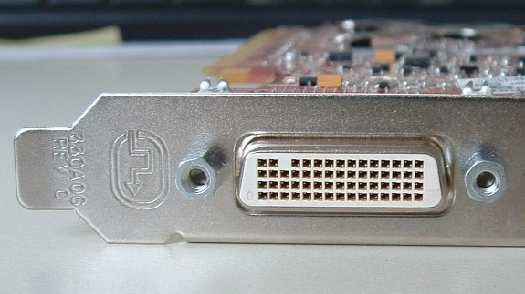
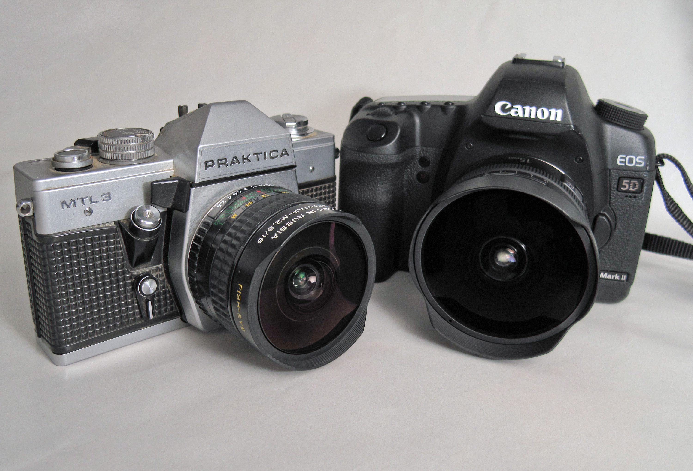
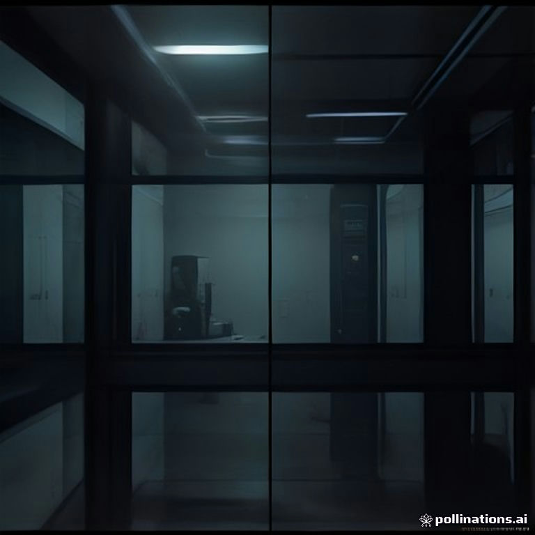

Thời kỳ đốt hàng nghìn USD thuê **editor video** dựng từng khung hình cho các kênh TikTok, YouTube Shorts hay Reels đã chính thức chấm dứt. Nghịch lý của giới làm **MMO** và phát triển kênh hiện đại là: nội dung cần liên tục 24/7 để nuôi thuật toán, nhưng chi phí nhân sự và thời gian render thủ công lại kéo sập biên độ lợi nhuận (ROI). Đứng trước bài toán này, các "cá mập" digital marketing đã chuyển dịch toàn bộ hạ tầng sáng tạo sang công nghệ **tạo video ai runway gen 3 kling ai**, kết hợp cùng chuỗi **tự động hóa** qua n8n và **Cloud VPS** tốc độ cao. 

Bài viết này từ **Smart Trader VIP & Tin Tức NFT** sẽ bóc tách toàn diện cách bạn có thể dựng một "nhà máy" sản xuất video hoạt họa và motion graphic triệu view với chi phí tối ưu nhất.

## 1. Bản Chất Vấn Đề: Tại Sao Tự Đựng Video Thủ Công Dễ Dẫn Đến "Cháy Tài Khoản"?

*Hình 1: Minh họa ngữ cảnh cho 1. Bản Chất Vấn Đề: Tại Sao Tự Đựng Video Thủ Công Dễ Dẫn Đến "Cháy Tài Khoản"?*

Nhiều nhà sáng tạo nội dung và nhà đầu tư MMO thường sa lầy vào những điểm nghẽn kỹ thuật kinh điển:
- **Tốn kém chi phí nhân sự:** Thuê một đội ngũ dựng phim, cắt ghép, tạo hiệu ứng motion graphic ngốn từ 500$ - 1500$/tháng cho mỗi nhân sự, trong khi sản lượng đầu ra không thể đáp ứng tốc độ quét thuật toán của nền tảng.
- **Rào cản công nghệ và bản quyền:** Việc tự mua lẻ các tài khoản cao cấp như **Runway Gen-3** hay **Kling AI** với giá retail trực tiếp từ trang chủ tiêu tốn một khoản tiền không nhỏ, bóp nghẹt ngân sách thử nghiệm campaign.
- **Vấn đề checkpoint và bảo mật tài khoản:** Sử dụng tài khoản "chùa", thẻ credit ảo trôi nổi hoặc không kết hợp với **Antidetect Browser (GPM Login)** và **Proxy dân cư sạch** khiến hệ thống quét chết hàng loạt tài khoản chỉ sau vài ngày nạp credit, mất trắng toàn bộ dữ liệu đang render.

> 💡 **Lưu ý thực chiến:** Muốn scale-up hệ thống làm kênh hàng loạt, bạn không thể làm theo phương pháp thủ công. Bạn cần một chu trình khép kín: **AI Generator + Cloud VPS mạnh + Antidetect Browser + Workflow tự động**.

## 2. Giải Pháp Toàn Diện: Kết Hợp Runway Gen-3 Và Kling AI Trong Hệ Thống Automation

*Hình 2: Minh họa ngữ cảnh cho 2. Giải Pháp Toàn Diện: Kết Hợp Runway Gen-3 Và Kling AI Trong Hệ Thống Automation*

Để sản xuất những thước phim hoạt họa 3D, cinematic hay motion graphic đạt chuẩn viral, việc phối hợp sức mạnh của hai con "quái vật" công nghệ là chìa khóa vàng:

### Sức Mạnh Của Runway Gen-3 Alpha Trong Chuyển Động Điện Ảnh
**Runway Gen-3 Alpha** nổi tiếng với khả năng hiểu ngữ cảnh văn bản (prompt) siêu việt, tạo ra các chuyển động camera mượt mà, chân thực đến từng chi tiết vật lý (ánh sáng, đổ bóng, chất liệu). Đây là công cụ tối thượng để tạo ra các phân cảnh mở đầu (hook) giật gân, giữ chân người xem ngay trong 3 giây đầu tiên.

### Kling AI - "Vũ Khí Bí Mật" Tạo Hoạt Họa Và Kéo Dài Video

*Hình 3: Minh họa ngữ cảnh cho Kling AI - "Vũ Khí Bí Mật" Tạo Hoạt Họa Và Kéo Dài Video*

Trong khi Runway mạnh về tính điện ảnh, **Kling AI** lại cực kỳ xuất sắc trong việc tái tạo chuyển động phức tạp của con người, vật thể và phong cách hoạt họa (anime, 3D cartoon). Kling AI giúp giải quyết bài toán kéo dài thời lượng video, đồng bộ hóa khung hình mà không bị vỡ nét hay biến dạng nhân vật.

### Quy Trình Vận Hành Tự Động Hóa (Workflow) Tối Ưu
Thay vì ngồi nhập prompt thủ công từng cái, các chuyên gia MMO ứng dụng **Python** kết hợp **n8n API** để kết nối trực tiếp với các mô hình AI này. 
1. **Bước 1:** Dùng ChatGPT/Claude để sinh hàng loạt kịch bản và prompt hình ảnh/video tự động.
2. **Bước 2:** Đẩy prompt qua API vào hệ thống tài khoản **Runway Gen-3** và **Kling AI** chạy trên môi trường **Cloud VPS** bảo mật bằng **GPM Login**.
3. **Bước 3:** Tự động gom file video xuất ra, ghép nối nhạc nền (tạo từ Suno/ElevenLabs) và auto-upload lên các nền tảng thông qua hệ thống lập lịch.

---

## 3. Bảng So Sánh Chi Phí & Hiệu Suất: Làm Thủ Công Vs. Hệ Thống AI Tự Động

*Hình 4: Minh họa ngữ cảnh cho 3. Bảng So Sánh Chi Phí & Hiệu Suất: Làm Thủ Công Vs. Hệ Thống AI Tự Động*

| Tiêu Chí Đánh Giá | Làm Phim Thủ Công (Truyền Thống) | Hệ Thống AI Tự Động (Runway + Kling + VPS) |
| :--- | :--- | :--- |
| **Chi phí hàng tháng** | 800$ - 2000$ (Lương editor + tool lẻ) | Tiết kiệm **60-80% chi phí**, tối ưu qua kho bản quyền sỉ |
| **Tốc độ sản xuất** | 1 - 2 video hoàn chỉnh / ngày | **Hàng chục đến hàng trăm video / ngày** |
| **Độ phủ thuật toán** | Thấp, do giới hạn sức người | Cực cao nhờ scale-up hàng loạt kênh |
| **Rủi ro tài khoản** | Phụ thuộc nhân sự nghỉ việc | An toàn tuyệt đối với Proxy sạch & Antidetect |
| **Chất lượng hình ảnh** | Phụ thuộc tay nghề editor | Đạt chuẩn Hollywood, cinematic & hoạt họa 3D |

---

## 4. Tối Ưu Hóa Ngân Sách Với Kho Tài Nguyên Bản Quyền AI

Bài toán kinh tế luôn đặt lên hàng đầu trong mọi chiến dịch MMO. Thay vì bỏ ra hàng trăm USD mua lẻ từng tài khoản **Runway Gen-3** và **Kling AI**, việc tiếp cận nguồn cung cấp tài khoản bản quyền số lượng lớn với chính sách bảo hành dài hạn là lối đi chiến lược giúp bạn vượt qua đối thủ cạnh tranh về tốc độ và chi phí.

Hạ tầng sạch, công cụ mạnh, kết hợp chiến lược phân phối nội dung thông minh chính là bệ phóng đưa kênh của bạn đạt triệu view bền vững mà không lo bị bóp tương tác hay khóa tài khoản.

---
## 🌐 Kho Tài Nguyên Bản Quyền AI & Hạ Tầng MMO Tự Động Hóa

Hạ tầng sạch và công cụ bản quyền ổn định chính là nền tảng quyết định thành bại của mọi dự án MMO & Automation:

- 🛒 **Kho Tổng 84+ Công Cụ AI & Bản Quyền MMO Giá Sỉ:** Khám phá trọn bộ 6 danh mục công cụ (Siêu AI, Coding Cloud, Creative Video/Voice, VPN Sạch & Tài Khoản Số) tại [Kho AI & Hạ Tầng MMO (tintucnft.com)](https://tintucnft.com/kho-ai-ha-tang-mmo).
- ⚡ **Mua Hàng Tự Động 24/7:** Giao dịch nhận tài khoản/key bản quyền siêu tốc trong 30 giây qua bot Telegram: [Bot Mua Tự Động (@chatgpsplusbot)](https://t.me/chatgpsplusbot).
- 🤖 **Kiểm Chứng Hiệu Suất Bot EA Myfxbook:** Truy cập ngay  [Bot EA MT5 (https://tintucnft.com)](https://tintucnft.com/bot-ea-trading) để xem track record thực tế với Max Drawdown dưới 10%.
- 🎁 **Quà Tặng Độc Quyền (Lead Magnet):** Nhận **License GPM Login chính hãng (Tặng Key Free)** kèm bộ **Data 50+ AI Prompts & Workflows** tự động hóa: [Nhắn Tin Admin (@willrich)](https://t.me/willrich).
- ✈️ **Cập Nhật Tín Hiệu & Chiến Lược Mỗi Ngày:** Tham gia ngay [Kênh Telegram MCG Community](https://t.me/channelmcg) để không bỏ lỡ các cảnh báo thị trường khẩn cấp.