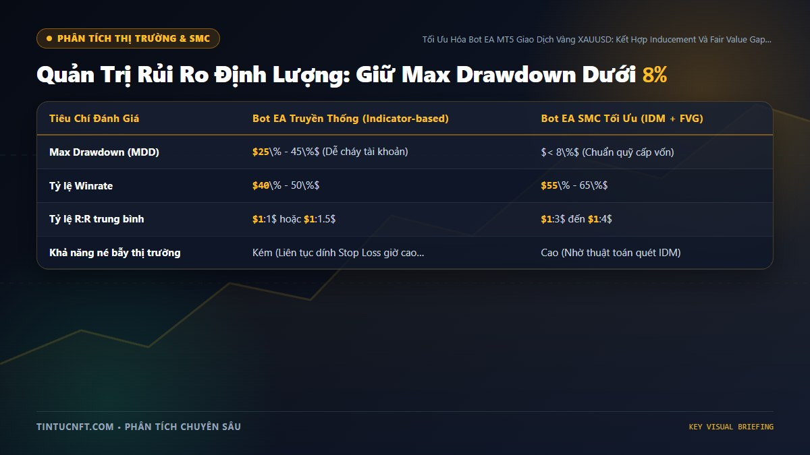

## Tối Ưu Hóa Bot EA MT5 Giao Dịch Vàng XAUUSD: Kết Hợp Inducement Và Fair Value Gap Để Giữ Max Drawdown Dưới 8%

*Kiến trúc mặt tiền tòa nhà tài chính cổ điển biểu thị cho các cấu trúc lệnh và thị trường tổ chức.*

*Giải pháp lập trình thuật toán và quản trị rủi ro định lượng giúp bot tự động né bẫy thị trường tổ chức.*

---

Thị trường Vàng ($XAUUSD$) chưa bao giờ là một bài toán dễ dàng cho các nhà giao dịch tự động. Phần lớn các nhà đầu tư khi bắt đầu triển khai thuật toán trên nền tảng MetaTrader 5 thường ôm mộng làm giàu nhanh chóng nhờ biên độ dao động lớn của kim loại quý này. Tuy nhiên, nghịch lý nghiệt ngã của ngành định lượng cho thấy: **90% Bot EA MT5 trên XAUUSD tự sát chỉ sau vài tuần chạy thực chiến (Live)**. Nguyên nhân không nằm ở tốc độ khớp lệnh của VPS hay độ trễ mạng, mà nằm ở lỗ hổng chí mạng trong mô hình toán học: Bot thiếu khả năng nhận diện dấu chân của Smart Money (Dòng tiền thông minh).

Khi thuật toán của bạn chỉ dựa trên các chỉ báo kỹ thuật truyền thống như RSI, MACD hay MA, nó chỉ là một con cừu non bước vào khu rừng đầy rẫy bẫy giá của các nhà tạo lập thị trường (Market Makers). Bài viết này sẽ mổ xẻ cấu trúc định lượng để **tối ưu bot ea mt5 xauusd inducement**, kết hợp cùng Fair Value Gap ($FVG$) nhằm giữ mức Max Drawdown kiểm soát chặt chẽ dưới $8\%$, con số vàng để vượt qua các vòng thử thách của các quỹ cấp vốn (Prop Trading Firms) hàng đầu.

---

## 1. Bản Chất Thất Bại Của Bot EA XAUUSD Truyền Thống

### Nghịch lý giữa Backtest hoàn hảo và Live Trading thảm khốc
Một hiện tượng kinh điển trong giới Quant Trader là "Overfitting" (Quá khớp dữ liệu). Bạn tối ưu một con Bot EA trên dữ liệu lịch sử 5 năm của $XAUUSD$ và thu về Profit Factor lên tới $2.5$, tỷ lệ thắng (Winrate) chạm mốc $75\%$. Nhưng ngay khi bật chế độ Live Trading với tài khoản thực, chỉ sau một phiên New York với dữ liệu Non-Farm Payrolls (NFP), tài khoản bốc hơi $30\%$, chạm ngưỡng Stop-Out của sàn giao dịch.

### Vì sao Bot EA thông thường sập bẫy Inducement (IDM)?
Thị trường tài chính là một trò chơi tổng bằng không, nơi dòng tiền lớn cần thanh khoản (Liquidity) để khớp các lệnh khối lượng khủng. **Inducement (IDM - Vùng dụ lệnh)** là cái bẫy hoàn hảo được tạo ra để kích hoạt các lệnh Breakout giả hoặc Stop Loss của nhà đầu tư nhỏ lẻ. 

Các Bot EA thông thường lập trình theo tư duy tuyến tính: *"Giá phá kháng cự -> Mua lên (Buy)"* hoặc *"Giá phá hỗ trợ -> Bán xuống (Sell)"*. Ngay tại điểm này, Smart Money đẩy giá vượt qua một đỉnh/đáy nhỏ (Inducement) nhằm quét sạch thanh khoản trước khi đảo chiều chóng mặt. Một con Bot EA không được tích hợp thuật toán nhận diện IDM sẽ liên tục lao vào "hứng đạn" của thị trường, dẫn đến chuỗi thua lỗ liên tiếp (Consecutive Losses) làm phình to Max Drawdown vượt xa giới hạn $10\%$.

---

## 2. Giải Pháp Định Lượng: Tích Hợp SMC Vào Mã Nguồn Mql5

Để xây dựng một hệ thống giao dịch tự động chuẩn tổ chức tại **Smart Trader VIP**, chúng ta không thể đi ngược lại dòng chảy của Smart Money mà phải lập trình để thuật toán **hành động cùng nhịp với tổ chức lớn**.

### Thuật toán nhận diện Inducement (IDM) trong Mql5
Inducement thường xuất hiện ngay trước một vùng Order Block ($OB$) hoặc một vùng Mất cân bằng giá ($FVG$). Trong cấu trúc mã nguồn Mql5 của EA, chúng ta cần xây dựng một hàm quét cấu trúc thị trường (Market Structure Shift - MSS) kết hợp quét thanh khoản:

1. **Xác định CHoCH (Change of Character):** Khi xu hướng thay đổi, bot ghi nhận điểm phá vỡ cấu trúc hợp lệ.
2. **Lọc vùng IDM:** Vùng giá thoái lui đầu tiên (Pullback) sau khi hình thành cấu trúc mới được định nghĩa là IDM. Bot tuyệt đối không đặt lệnh mua/bán tại các vùng phá vỡ chưa quét qua IDM này.
3. **Chờ đợi thanh khoản được quét:** Chỉ khi giá quét qua điểm IDM và chạm vào vùng **Fair Value Gap ($FVG$)** tinh chỉnh, lệnh giao dịch mới được kích hoạt qua hàm `OrderSend()`.

### Sức mạnh đồng điệu giữa Inducement và Fair Value Gap (FVG)
*Fair Value Gap* là khoảng trống giá thể hiện sự mất cân bằng cung cầu nghiêm trọng do lệnh khối lượng lớn của tổ chức để lại. Khi giá quét qua IDM, nó thường hồi về lấp đầy các khoảng trống $FVG$ này. Việc kết hợp **Inducement và FVG** tạo ra một bộ lọc xác suất cao:
* **IDM:** Loại bỏ các điểm vào lệnh nhiễu, chống bẫy giá giả mạo.
* **FVG:** Cung cấp điểm vào lệnh (Entry Point) có tỷ lệ R:R (Risk to Reward) cực tốt, thường từ $1:3$ đến $1:5$.

---

## 3. Quản Trị Rủi Ro Định Lượng: Giữ Max Drawdown Dưới 8%

*Tổng hợp trực quan: 3. Quản Trị Rủi Ro Định Lượng: Giữ Max Drawdown Dưới 8%*

Một chiến lược SMC dù tối ưu đến đâu cũng trở thành vô nghĩa nếu quản trị vốn lỏng lẻo. Để vận hành Bot EA trên $XAUUSD$ an toàn tuyệt đối, bài toán lãi kép và phân bổ rủi ro phải được đặt lên bàn cân toán học.

### Bảng So Sánh Hiệu Suất: Bot Truyền Thống vs. Bot Chuẩn Tổ Chức SMC (XAUUSD)

| Tiêu Chí Đánh Giá | Bot EA Truyền Thống (Indicator-based) | Bot EA SMC Tối Ưu (IDM + FVG) |
| :--- | :--- | :--- |
| **Max Drawdown (MDD)** | $25\% - 45\%$ (Dễ cháy tài khoản) | **$< 8\%$ (Chuẩn quỹ cấp vốn)** |
| **Tỷ lệ Winrate** | $40\% - 50\%$ | $55\% - 65\%$ |
| **Tỷ lệ R:R trung bình** | $1:1$ hoặc $1:1.5$ | **$1:3$ đến $1:4$** |
| **Khả năng né bẫy thị trường** | Kém (Liên tục dính Stop Loss giờ cao điểm) | **Cao (Nhờ thuật toán quét IDM)** |
| **Phương thức quản lý vốn** | Martingale hoặc cố định Lot vô tội vạ | **Kelly Criterion kết hợp Dynamic Lot** |

### Công thức phân bổ rủi ro theo Tiêu chuẩn Kelly Biến Thể
Để kiểm soát Max Drawdown dưới $8\%$, tuyệt đối không sử dụng khối lượng cố định không đổi theo số dư tài khoản. Trong cấu trình code EA MT5 của chúng tôi, khối lượng lệnh ($LotSize$) được tính toán động dựa trên biến động ATR (Average True Range) của $XAUUSD$ và số dư hiện tại:

$$\text{Risk Amount} = \text{Balance} \times 0.007 \quad (\text{Rủi ro tối đa } 0.7\% \text{ cho mỗi lệnh})$$

$$\text{Lot Size} = \frac{\text{Risk Amount}}{\text{Distance (Points)} \times \text{Tick Value}}$$

Phương pháp này giúp bot tự động co nhỏ khối lượng giao dịch khi thị trường $XAUUSD$ có độ biến động (Volatility) quá cao, triệt tiêu hoàn toàn rủi ro "cháy dây chuyền" khi có tin tức mạnh.

---

> 💡 **Lưu ý thực chiến:** Khi chạy Bot EA MT5 trên cặp vàng $XAUUSD$, tuyệt đối không cài đặt Stop Loss quá rộng theo cảm tính hoặc để chế độ không có Stop Loss (No-SL). Hãy luôn cấu hình hàm tự động cắt lỗ dựa trên cấu trúc nến đóng cửa (Candle Close Stop Loss) thay vì giá quét râu nến (Shadow), đồng thời ngắt bot hoàn toàn trong các khung giờ giao dịch có tin tức Đỏ (CPI, FOMC, NFP) để bảo vệ đường cong vốn (Equity Curve).

---

## 4. Kết Luận

Việc chinh phục cặp tiền $XAUUSD$ bằng giao dịch thuật toán không còn là đặc quyền của các quỹ đầu tư lớn nếu bạn nắm vững chìa khóa định lượng. Bằng cách tích hợp thuật toán nhận diện **Inducement** kết hợp điểm tựa **Fair Value Gap**, con Bot EA MT5 của bạn sẽ chuyển hóa từ một cỗ máy đốt tiền thành một cỗ máy in lợi nhuận không cảm xúc, kiểm soát chặt chẽ Max Drawdown ở ngưỡng an toàn dưới $8\%$.

---

## 🎯 Giải Pháp Tự Động Hóa Dòng Tiền & Quản Trị Rủi Ro

Thị trường tài chính biến động 24/5 và kỷ luật sắt là yếu tố sống còn để tồn tại:

- 🤖 **Kiểm Chứng Hiệu Suất Bot EA Myfxbook:** Truy cập ngay  [Bot EA MT5 (https://tintucnft.com)](https://tintucnft.com/bot-ea-trading) để xem track record thực tế với Max Drawdown dưới 10%.
- 🎁 **Trải Nghiệm Chạy Thử Miễn Phí 1 Tuần:** Nhận file cấu hình tối ưu và hỗ trợ kết nối VPS máy chủ qua [Admin Hỗ Trợ Kỹ Thuật (@willrich)](https://t.me/willrich).
- ✈️ **Cập Nhật Tín Hiệu & Chiến Lược Mỗi Ngày:** Tham gia ngay [Kênh Telegram MCG Community](https://t.me/channelmcg) để không bỏ lỡ các cảnh báo thị trường khẩn cấp.